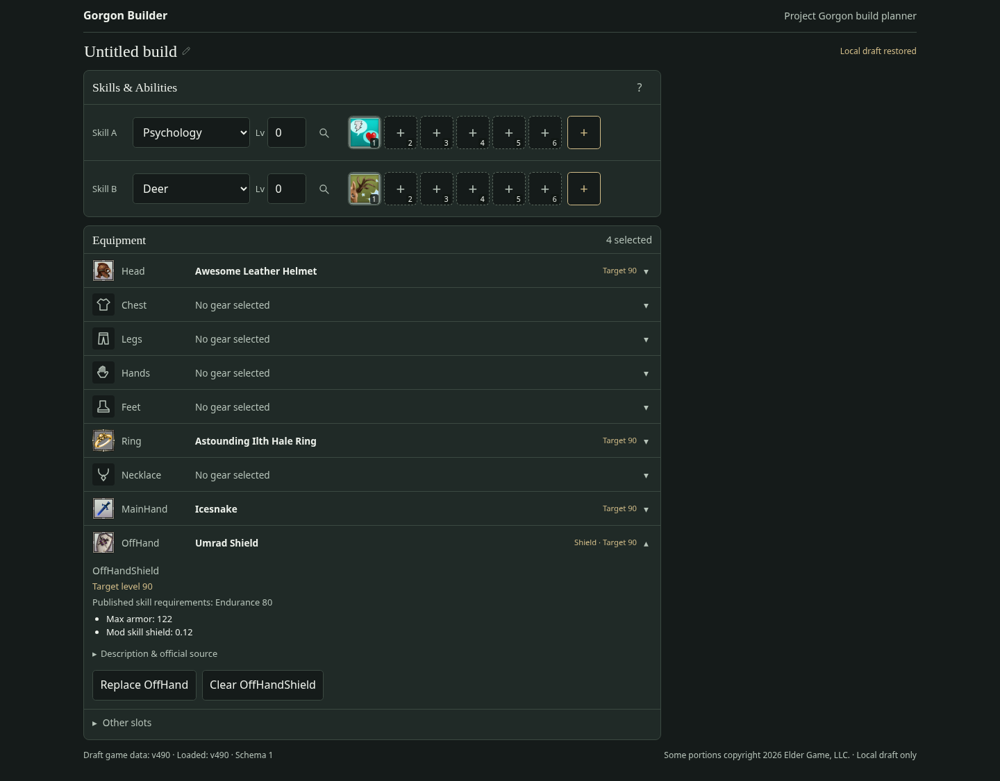
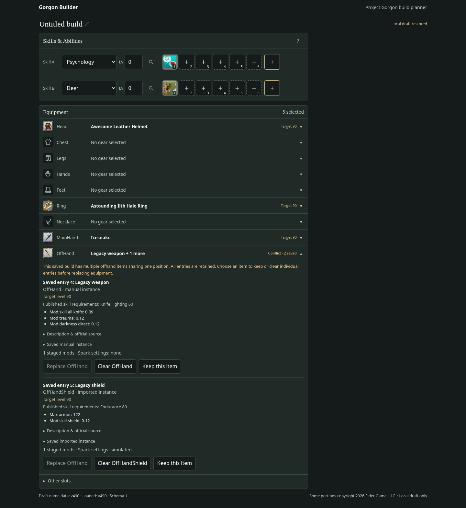

# T0009-F1 — Compact Equipment Details and Exclusive Offhand Position

**Status: Completed and customer-accepted 2026-11-01.** [PR #20](https://github.com/Zaelious/GorgonBuilder/pull/20) was reviewed at head `d90cbcd` and squash-merged into `main` as `09257ce95ae7e6e5500d10cdfbf58ace9ad84b75`. The customer confirmed “this is good, go ahead and commit/merge.” T0010 has not started.

Branch: `fix/t0009-f1-equipment-ui`, created from latest fetched main at `e0a02a7`. Merged T0009 was confirmed in GitHub and local history: PR #18, squash commit `7cd03eef7aaf4bea7bf79fcb3850bf7d6d03746d` (reviewed head `6bbe60f`).

Read AGENTS.md, the F1 ticket, repository state, manual verification guide, KI-0011, relevant full/MVP designs, and the existing equipment UI/picker, immutable edits, schema-v1 document, preferences, storage and autosave implementations before editing.

## Result

Expanded ordinary equipment details no longer repeat the summary's image/name header. Head, MainHand, Ring and OffHand retain their single persistent identity/icon summary; target level, published skill requirements, all fixed effects, descriptions, provenance, saved-instance details and Replace/Clear remain available below it. Legacy multiple-entry rows use small text labels to identify the separate saved records for explicit resolution; no second artwork/header is added.

OffHand is now one physical loadout position with one picker. Its results include both exact official types, OffHand and OffHandShield, with visible type labels. Replacing a weapon with a shield or vice versa changes the selected database ID and canonical slot in place. It never rewrites a shield to OffHand.

Mutual exclusivity is enforced in `editBuild`, independently of the UI:

- An explicit indexed replacement can swap between the two offhand types, preserving associated candidate mods and Spark settings.
- An add with `index: null` is rejected if either type already occupies the position. Callers must explicitly replace the existing index; this preserves the previous protection against implicit overwrite of manual/imported selections.
- Ordinary offhand equip operations are rejected when multiple legacy occupants exist, even if a caller bypasses the picker. Unrelated edits retain those occupants unchanged.
- A dedicated explicit `equipment-resolve-offhand` edit keeps the chosen existing entry, including its exact instance/powers/metadata/mods/Sparks, and removes only other offhand entries. Invalid indices and incompatible snapshots are rejected. This is an edit command, not a saved-schema extension.

Legacy dual-type (and duplicate-type) builds load without automatic migration/deletion. The persistent row summary shows Conflict and the saved-entry count; expanding it explains the conflict and exposes every retained entry. Replace stays disabled until the user explicitly clears entries or chooses Keep this item. Keeping an entry always asks for confirmation naming the kept/removed items and warning that removed entries lose their associated data. Cancel changes nothing.

The existing manual/imported replacement confirmation remains in force for cross-type swaps. Choosing to replace an instance explicitly discards its instance metadata/existing powers after confirmation; staged mods and Spark settings survive. Clear with associated data retains its existing confirmation. No automatic merging or guessed transfer of instance powers was introduced.

The other 17 published slot types, original database IDs, BuildDocument schema v1, preferences and 500 ms autosave are unchanged. Both skill bars and unrelated equipment/targets/notes/metadata remain preserved. Search text/level semantics, icons, Other slots, read-only/recovery/error states, X/Escape focus restoration and drag-safe disabled backdrop dismissal remain intact. Official data, normalization, generated artifacts, integrity/loader code, persistence implementations, dependencies and skill/ability code were not changed.

## Files changed

| File(s) | Purpose |
| --- | --- |
| `src/app/editor/build-editor.ts` | Shared offhand type predicate, guarded cross-type replacement, explicit legacy resolution |
| `src/features/equipment/EquipmentPlanner.tsx` | Remove duplicate detail header; one offhand control; conflict display/confirmation; canonical selected slot |
| `src/features/equipment/EquipmentPicker.tsx` | Combined offhand candidates using the existing pure filters, with type labels |
| `src/features/equipment/equipment.css` | Remove obsolete header/group styles; small saved-entry/conflict labels |
| `src/features/equipment/equipment-editor.test.ts` | Direct edit, canonical ID/slot, save/reload, preservation and legacy guards |
| `src/features/equipment/EquipmentPlanner.test.tsx` | Compact header, unified picker, swap confirmations, legacy resolution and read-only regressions |
| `src/features/equipment/equipment.smoke.py` | Extend the existing real-browser workflow with F1 assertions, swaps, legacy recovery and screenshots |
| `docs/T0009_F1_Verification.md` | This review/acceptance record |
| `docs/screenshots/t0009-f1/*.png` | Four actual production-preview browser captures |

## Automated checks

Environment: Node 24.19.0, npm 11.9.0. Passed:

```bash
npm ci --cache /tmp/gorgon-npm-cache
npm run data:update -- --check
npm run lint
npm run typecheck
npm test
npm run build
git diff --check
XDG_CONFIG_HOME=/tmp/t0009-f1-wrangler-config npx wrangler deploy --dry-run --outdir /tmp/t0009-f1-wrangler-dry-run
CHROMIUM_TRUST_HOME=/tmp/t0009-chromium-home python src/features/equipment/equipment.smoke.py --output /workspace/artifacts/t0009-f1/browser
CHROMIUM_TRUST_HOME=/tmp/t0009-chromium-home python src/test/vite-transport.smoke.py --output /workspace/artifacts/t0009-f1/transport
```

Full suite: **418 passing tests across 15 files**, including ten new F1 cases. Focused equipment/editor run: **47 passing tests**. Existing legacy UI assertions were updated for the new conflict policy and one-picker layout while retaining their preservation checks. New coverage includes:

- Head/MainHand/Ring/OffHand expanded rows: one icon, no duplicate detail name/image header, facts and actions retained.
- Both directions of canonical weapon/shield replacement, exactly one occupant after fresh persistence restore, actual official IDs/slots and schema v1.
- Staged mods/Sparks and unrelated skill slots/bars/target/notes/import metadata preserved through direct operations.
- Direct implicit additions, wrong-slot replacements and edits to legacy conflicts rejected.
- Legacy restore/unrelated edits retaining every payload; explicit keep preserving the selected imported instance and associated data, invalid resolution rejected.
- UI cancellation before destructive instance replacement/resolution; incompatible read-only conflict controls disabled.

All 13 raw datasets validated offline. Existing v490 search/count tests still pass (518 known 90+ target definitions and 500 unknown). No artifact regeneration was needed. Wrangler dry-run validated the static bundle without direct deployment. Temporary npm/Wrangler paths are writable under `/tmp`; the Chromium NSS trust store retains the injected environment CA with TLS validation enabled. Executor network permission supports the local integration/browser servers. No dependency or environment configuration change was required.

## Actual Chromium evidence

Chromium **154.0.8037.57**, driven by installed Python Playwright, passed actual `npm run dev` on port 5175 and `npm run preview` of the production build on 4175. Both 1440×900 desktop and 375×812 mobile workflows passed with no horizontal overflow.

In each serving mode the browser selected `item_45722` / OffHand, swapped to `item_45052` / OffHandShield, back to the weapon, and back to the shield. It reloaded after every step and asserted exactly one occupant with the exact canonical slot and official ID. Original ability bars and unrelated document fields were compared with the initial draft. Head/Ring/MainHand/OffHand expansions each contained one icon and no repeated heading; source facts, fixed effects and actions remained accessible.

The browser also seeded a valid schema-v1 legacy draft containing a manual weapon and imported shield, both with associated planning data. It verified unchanged storage bytes after restore/autosave delay, visible conflict/count, disabled replacements, mobile no-overflow and preservation through an unrelated level edit. Cancelling Keep changed no stored bytes. Confirming Keep retained the selected shield's entire instance metadata, existing powers, candidate mods and Spark configuration. A subsequent imported-shield-to-database-weapon swap required the existing confirmation; cancelling retained the instance, and confirming preserved candidate mods/Sparks. All steps were checked after save and reload.

Normal and legacy equipment workflows produced **zero console errors and zero page exceptions** in both modes. The existing isolated deliberate icon-404 case still produced the expected fallback, with its known resource-404 console message recorded separately. Keyboard expansion, pagination, X/Escape close/focus return, actual search-text drag outside without dismissal, unknown-target toggling, persisted minimums, icons and Other slots also passed.

The unchanged KI-0008 browser smoke passed compressed lengths/SHA-256, Content-Type application/gzip and absent Content-Encoding for all three assets in dev and preview. Every same-size corrupted artifact response was rejected; Retry recovered. Existing Psychology/Deer, Cow/Unarmed, same-skill, one-skill and ability-edit/reload checks passed. Asset bytes remain the merged T0009 values: progression 912,081; abilities 566,143; itemsTreasure 1,824,985, with unchanged manifest hashes.

Observed initial loads were 1,521 ms (dev) and 1,425 ms (preview), unthrottled in this environment. These are observations, not a low-end-device performance guarantee. KI-0009 remains a separate monitoring concern.

Full results, confirmation messages, swap IDs/counts, gzip headers/hashes, timing/heap observations and screenshots remain under `/workspace/artifacts/t0009-f1/browser/` and `/workspace/artifacts/t0009-f1/transport/`. The extended browser script is repeatable from the command above.

## Review screenshots

Actual production-preview captures are committed for review:





[Compact mobile details](screenshots/t0009-f1/compact-mobile.png) · [Legacy conflict on mobile](screenshots/t0009-f1/legacy-conflict-mobile.png)

## Customer acceptance checklist

1. Expand equipped Head, MainHand, Ring and OffHand rows: confirm the image/name remain once in the persistent summary, while facts, requirements, descriptions and Replace/Clear remain available.
2. In the single OffHand picker, search `item_45722`, equip it, refresh; search `item_45052`, replace it, refresh; switch back. Confirm one occupant at every step and the correct visible type/official saved slot.
3. Try representative text searches and target-level/unknown toggles. Verify the minimum preference persists and filtering never clears saved gear.
4. Open an older dual-offhand draft. Confirm the Conflict badge and all original entries/metadata remain, including after refresh or an unrelated edit. Replacement must be blocked while the conflict exists.
5. Choose Keep this item, cancel the confirmation and verify nothing changes. Confirm the same action and verify only the named other offhand entries are removed, with the kept instance/mods/Sparks unchanged. Alternatively, explicitly clear one saved entry.
6. Replace a manual/imported occupant with the opposite type: verify cancellation retains its metadata, and confirmed replacement keeps staged mods/Spark settings. Check both skill bars and other equipment after reload.
7. Repeat common actions by keyboard and on mobile. Confirm X/Escape return focus, drag selection outside remains safe, and clicking the backdrop still leaves the picker open (KI-0010 is out of scope).
8. Give architectural review and customer acceptance before merge/status updates. Do not start T0010 as part of this follow-up.

## Risks, assumptions and follow-ups

- The shared physical offhand position follows the explicit F1 product-owner contract. Canonical source slot strings remain distinct; no other equipment legality rule is inferred.
- Explicit legacy resolution is intentionally destructive to the entries the user chooses to remove. It requires confirmation naming them, retains the chosen entry exactly and never runs automatically. There is no guessed merge of incompatible instance powers/mod/Spark payloads.
- Preserved mods/Spark settings may not apply to a replacement definition. Eligibility/editor/calculation work remains future T0010/later scope; this ticket only preserves data.
- Browser evidence covers local Chromium, not all engines, low-end hardware or the deployed Cloudflare runtime. The Wrangler dry-run is not a live runtime test.
- No new unrelated issue was implemented. KI-0010 optional backdrop dismissal remains unchanged; KI-0009 monitoring remains open. Treasure-mod editing, Spark editing/simulation, calculations, imports and remote persistence remain untouched.

After acceptance, the architectural review on PR #20 found no blocking issues, CI and Cloudflare checks passed, and the PR was squash-merged. A separate documentation synchronization records completion in Tickets, Repo_Current_State, Manual_Verification_Guide and KI-0011, and clarifies the exclusive offhand position in MVP/build-save design notes. The optional backdrop-click improvement (KI-0010) remains a separate nonblocking follow-up.
