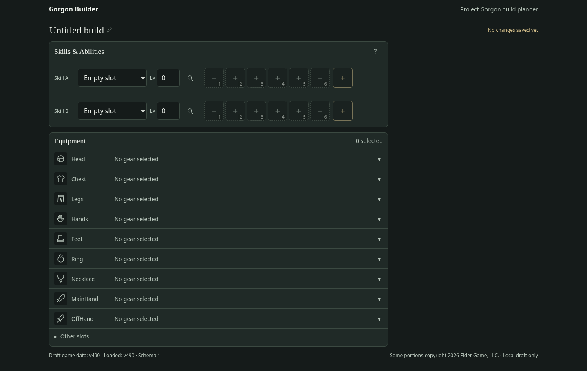
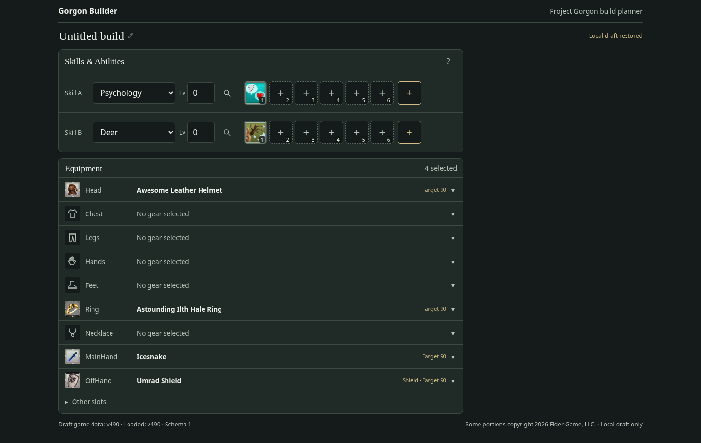

# T0009 — Equipment Search and Planner verification

**Status: Completed and customer-accepted 2026-11-01.** [PR #18](https://github.com/Zaelious/GorgonBuilder/pull/18) passed final architectural review at head `6bbe60f` and was squash-merged to `main` as `7cd03eef7aaf4bea7bf79fcb3850bf7d6d03746d`. The customer accepted the revised live equipment layout after the earlier functional checklist passed. T0010 has not started. Optional click-outside-to-close is a nonblocking future UX follow-up (KI-0010); the accepted picker continues using X/Escape.

## Review and scope

The initial implementation at `1ae26fe` passed 399 tests, received architectural review without blocking code issues, and passed the customer's functional checklist. The [latest product-owner review](https://github.com/Zaelious/GorgonBuilder/pull/18#pullrequestreview-5728992620) requests a bounded UI revision: nine always-visible loadout rows, generic/official item icons, a collapsed advanced area, distinct offhand/shield semantics, and removal of backdrop dismissal with a drag regression. This revision implements all six requested refinements in the same PR.

The branch remains based on main `b06e049d348e936c1e9a2e5619104435d7921df4`. Confirmed merged prerequisites: T0006 `4d29f7a`, T0007 `fa6eb43`, T0008 `dd268de`, and KI-0008 `b9b75f2` / PR #16. Reviewed AGENTS.md, the ticket and required design/persistence/normalization/manual-verification documents, actual editor/repository/schema/preferences/autosave code, and the full PR review before revising.

The review explicitly authorizes a narrow display-only normalization/runtime artifact extension for official `IconId`. It supersedes the initial task's restriction on changing those files for this purpose. No raw snapshot bytes, game mechanics, integrity logic, or gzip serving behavior were changed.

## Revised UI and preserved behavior

- Nine primary rows always appear: Head, Chest, Legs, Hands, Feet, Ring, Necklace, MainHand and OffHand. Each compact summary contains a category/item icon, slot, selected name or No gear selected, and an expand affordance. Native details summaries work with pointer, Enter and Space. Item facts and slot-specific picker actions appear inside expanded rows.
- Other slots is collapsed by default. It exposes the remaining official slots and retains unknown legacy saved slots. The count of selected non-primary entries remains visible on its summary. No site-wide navigation/catalog was added.
- The visible OffHand row contains separate OffHand and OffHandShield sections and picker controls. A shield-only summary identifies Shield. Both canonical slot strings remain unchanged in BuildDocument; multiple/legacy entries remain individually inspectable and actionable by original selection index.
- Empty slots use consistent local equipment line drawings. Selected items and picker results use their exact published official artwork when available; missing/failed artwork falls back to a category drawing. Head/Ring/MainHand/OffHandShield artwork was verified in real Chromium.
- Backdrop dismissal is removed from the equipment picker. Dragging search text outside or clicking the backdrop retains the dialog and query. X and Escape close it and restore focus to the opener; if equipping replaced the opener, focus returns to the persistent row summary.
- Detailed fixed effects, target level, SkillReqs, descriptions, exact tokens and provenance stay in expanded rows or the picker. The expanded row content can accommodate a future mod panel without fixed sizing; this revision adds no mod/Spark controls or placeholder panel.

Original behavior is preserved: pure NFKC/case/whitespace/underscore substring search, explicit symmetric lightning/electricity synonyms, exact slots, ten results per page, nullable target-level threshold (default 90), transient default-on unknown inclusion, and schema-v1 preference persistence. Filters never unequip selections. CraftingTargetLevel remains a browsing hint, separate from published SkillReqs and confirmed equip requirements.

Equip/replace/clear still use the original immutable edits and 500 ms protected autosave. Both skill bars and unrelated build fields survive. Manual/imported instances, duplicate selections, candidate mods and Spark data remain retained through unrelated changes. Explicit instance replacement/associated-data clearing retains its existing confirmation. No editor, persistence API, saved schema or search predicate changes were needed for this revision.

## Official icon extension and deterministic output

Inspected `src/data/raw/cache/v490/items.json`: all **3,078 equipment definitions publish integer IconId** (official spelling differs from ability IconID). Examples: `item_45640` → 15208, `item_45052` → 14009, `item_49070` → 17202. The existing official index documents `https://cdn.projectgorgon.com/v490/icons/icon_{IconId}.png`.

`NormalizedItem.iconId` copies the exact nonnegative safe integer; an absent source field becomes null. Malformed present values fail with the source path. The existing runtime projection automatically includes it. No IDs or artwork are synthesized, and no unrelated artwork source is used.

Ran generation twice and compared all four generated-file SHA-256 values: byte-identical. Only itemsTreasure and manifest metadata changed relative to the original PR:

| Artifact | Compressed bytes | Decoded JSON bytes | SHA-256 |
| --- | ---: | ---: | --- |
| progression | 912,081 | 24,512,764 | `3e9c01e629d18bac727a8e82138011951def5f067454e4f121036147d41bb915` |
| abilities | 566,143 | 16,214,378 | `0606099fad944d22c9330bf9c310e78e2feaeda9db02a208d808b63a4e9e41c7` |
| itemsTreasure | 1,824,985 | 31,653,251 | `90ea272a7804075fc8474e1150119512b3dddb9b2806626ee350aac789411487` |

The item gzip grew by 3,736 bytes. All source hashes, official IDs/slots, record counts and diagnostics remain unchanged. Existing compressed length/hash verification, explicit gzip decoding, JSON-length and schema/version checks remain intact. BuildDocument and preferences stay at schema v1.

Pinned v490 regressions remain: **3,078 equipment definitions, 518 known target levels at 90+, 500 unknown, 1,018 when unknowns are included at 90+**. Tests still cover 89/90/91/null, disabled minimum, and composed text/slot/level filters.

## Files changed for this revision

| Files | Purpose |
| --- | --- |
| `src/features/equipment/EquipmentPlanner.tsx` | Nine compact rows, advanced slots, exact offhand grouping, preserved selections and focus targets |
| `src/features/equipment/EquipmentPicker.tsx` | Official result icons, removal of backdrop dismissal, row-focus fallback |
| `src/features/equipment/EquipmentIcon.tsx` | Official icon URL validation, per-slot line drawings and failed-artwork fallback |
| `src/features/equipment/equipment.css` | Compact responsive rows and icon/expanded-content styling |
| `src/features/equipment/EquipmentPlanner.test.tsx` | Preserve original workflow assertions with new selectors; offhand/legacy/duplicate preservation, backdrop and icon regressions |
| `src/features/equipment/equipment.smoke.py` | Real row/drag/icon/fallback/advanced-slot browser assertions and screenshots |
| `src/data/normalized/items-treasure.ts` | Display-only nullable iconId contract |
| `src/data/adapters/normalize-items-treasure.ts` | Exact official IconId projection |
| `src/data/adapters/normalize-items-treasure.test.ts` | Missing/malformed/published icon cases |
| `scripts/generate-data.test.ts` | Exact raw-to-runtime icon/provenance checks for all 3,078 equipment definitions |
| `src/generated/game-data/itemsTreasure.json.gz`, `manifest.json` | Deterministically regenerated item data and metadata |
| `src/data/normalized/README.md` | Reviewed display-only extension, source spelling, provenance and artifact changes |
| `docs/T0009_Verification.md` | Current revision evidence and customer checklist |
| `docs/screenshots/t0009/*.png` | Four actual Chromium production-preview captures for PR review |

Original PR files additionally cover pure equipment search/tests, immutable build-editor operations, App preference/editor integration, ItemFacts and persistence/editor regressions. They are unchanged by this UI revision. Raw data, repository loader/integrity, KI-0008 transport/Vite configuration, dependency files, skill/ability UI and treasure-mod/Spark implementations remain unchanged.

## Commands and results

Node 24.19.0, npm 11.9.0. Successful checks:

```bash
npm ci --cache /tmp/gorgon-npm-cache
npm run data:update -- --check
npm run data:generate
sha256sum src/generated/game-data/* > /tmp/t0009-icons-first-generation.sha256
npm run data:generate
sha256sum --check /tmp/t0009-icons-first-generation.sha256
npm run lint
npm run typecheck
npm test
npm run build
git diff --check
XDG_CONFIG_HOME=/tmp/t0009-wrangler-config npx wrangler deploy --dry-run --outdir /tmp/t0009-wrangler-dry-run
CHROMIUM_TRUST_HOME=/tmp/t0009-chromium-home python src/features/equipment/equipment.smoke.py --output /workspace/artifacts/t0009/revision/browser
CHROMIUM_TRUST_HOME=/tmp/t0009-chromium-home python src/test/vite-transport.smoke.py --output /workspace/artifacts/t0009/revision/transport
```

Full suite: **408 tests across 15 files**, retaining all earlier behavioral coverage and adding nine cases. Focused adapter/generator/UI run also passed (89 tests). Lint, both strict TypeScript projects, build, raw validation, deterministic regeneration, whitespace checks and Wrangler static-assets dry-run passed. No direct deployment or merge was performed.

Environment setup follows the original verification: writable `/tmp` npm cache and Wrangler config/output, executor network access for local test servers, inherited HTTPS proxy, and injected environment CA trusted in a temporary Chromium NSS store. TLS verification remains enabled. No runtime/test dependency was added.

## Actual browser evidence and screenshots

Installed Chromium **154.0.8037.57** with Python Playwright exercised actual Vite dev (5175) and built production preview (4175), at 1440×900 and 375×812. Both modes passed:

- Nine empty primary rows, category icons, native keyboard expansion and directly available slot picker actions. Empty desktop rows are 49 px including borders; the full nine-row equipment section plus Other slots is 526 px.
- All 19 canonical slots; initially collapsed advanced area and an accessible Horseshoes picker.
- Real Head, Ring, MainHand and OffHandShield choices with exact CDN URLs and loaded 64×64 official artwork. Selected-state and shield labeling are visible.
- Actual pointer drag from search text beyond the dialog boundary and a separate backdrop click: dialog/query remain intact. X/Escape close with focus restoration; equipping into an empty row returns focus to its summary.
- Original target-level/unknown/text filters, no-results state, official provenance/exact-effect disclosure, pagination, equip/replace/clear/reload, retained equipment under changing filters, and unchanged skill bars/document fields.
- Mobile picker and overview without horizontal page overflow. Normal workflows produced **zero console errors and zero page errors**.
- An isolated forced CDN 404 rendered the category fallback while keeping the selected name. Its expected resource-404 console message is explicitly recorded separately; no page exception occurred. Missing icon metadata and recovery to another icon are also unit-tested.

The unchanged KI-0008 browser regression passed both modes with the newly generated manifest: all three browser-received compressed byte counts/hashes matched, Content-Type was application/gzip, and Content-Encoding was absent. Same-size corrupt responses for every artifact were rejected, Retry recovered, and existing Psychology/Deer, Cow/Unarmed, duplicate-skill, one-skill and ability-edit/reload flows passed.

Review screenshots from the actual production-preview browser run are committed:





[Mobile selected layout](screenshots/t0009/selected-mobile.png) · [Deliberate icon-404 fallback](screenshots/t0009/icon-fallback.png)

Additional revision artifacts are outside Git under `/workspace/artifacts/t0009/revision/`:

- `browser/results.json`, `browser.log`, and `{dev,preview}-{empty-desktop,overview-desktop,overview-mobile,picker-desktop,picker-mobile,icon-fallback}.png`.
- `transport/results.json`, `transport.log` and dev/preview planner screenshots.

The final chat response links current desktop/mobile screenshots directly. Initial-run artifacts under `/workspace/artifacts/t0009/browser` and `/workspace/artifacts/t0009/transport` remain available as historical evidence.

The original pure-search measurement remains applicable because search code is unchanged: five warmups and 30 samples across seven queries; MainHand/Feet medians approximately 0.27–0.71 ms, all-slot medians 3.02–5.67 ms and measured p95 at most 10.34 ms. Browser results additionally record load latency, interaction round trips and CDP heap before/after explicit GC. These are unthrottled local measurements, not low-end mobile performance guarantees; KI-0009 remains relevant. No search cache, partitioning or new architecture was added.

Final revision run, measured alongside the test suite: dev load 2,027 ms and preview load 1,189 ms. Target-specific CDP heap after explicit GC was 78,377,304 → 80,011,952 bytes in dev and 74,390,976 → 75,693,580 bytes in preview (initial load → completed workflow). Temporary allocations before GC are recorded separately in results.json.

## Customer acceptance recheck

1. Open a fresh draft: see all nine empty primary rows with meaningful icons and No gear selected. Use pointer and keyboard to expand Head, Ring, MainHand and OffHand and open their pickers.
2. Equip Head/Ring/MainHand items and a shield through OffHand → Shields (OffHandShield). Check official artwork, selected names and shield labeling; expand OffHand to inspect its two distinct canonical sections.
3. Expand Other slots, browse an unusual slot such as Horseshoes or Racial, then collapse it. Verify selected non-primary gear remains discoverable via the count.
4. Search lightning/electricity, psychic, taunt, kick and combat refresh in suitable slots. In Feet search item_40002, toggle unknown levels at minimum 90, then clear the minimum. Try minimum 80 and refresh to check preference persistence.
5. Inspect item_45640: target level 90, separate Knife Fighting 60 requirement, fixed effects, description and official source. Check that target level is not presented as an equip requirement.
6. Drag search text outside the dialog and click its backdrop: it stays open. Close with X/Escape and verify focus returns. Page through results using the keyboard.
7. Equip multiple slots, replace and clear, refresh after each, and verify both ability bars, title, notes and other equipment persist. Existing manual/imported/duplicate selections must remain unless explicitly changed; associated-data confirmation still applies.
8. Review the forced-404 fallback evidence and repeat common actions on a narrow screen. Final architectural review and customer acceptance were subsequently completed; see the status at the top of this report.

## Post-merge product-owner correction (not yet implemented)

After accepting and merging T0009, the customer identified two further issues: an expanded item row repeats its own summary's icon/name, and OffHand versus OffHandShield must be alternative item types in one mutually exclusive offhand loadout position. The merged version currently permits both canonical types to be selected at once, so this is a **known follow-up**, not a passed acceptance claim. T0009-F1 documents the fix; no modifications to the merged code are claimed. Preserve both entries of legacy dual-selection drafts until deliberate resolution, and preserve exact official slot strings. See KI-0011.

## Risks, assumptions, follow-ups and documentation

- Official CDN artwork can be missing or unavailable; the category fallback is deliberate. All pinned equipment records have IconId, so absent metadata is covered by synthetic unit tests rather than an invented official record.
- UI grouping of OffHand/OffHandShield does not assert that both can legally be worn together. The planner retains both canonical selections and defers mechanics/eligibility decisions.
- Fixed effects remain uninterpreted; token formatting does not infer units or percentages. Retained mods/Spark settings may not apply to replacement gear and need later eligibility validation.
- Legacy unknown slots and duplicate entries remain preserved. Their presence does not invent official slot mappings or add a character-import workflow.
- T0010 mod candidate selection/tier editing, skill/profile eligibility, numeric stats, Spark simulation, damage calculations, imports and remote persistence remain out of scope. No new unrelated issue was implemented.
- Browser coverage is local Chromium, not all engines, low-end hardware or the live Cloudflare runtime. Wrangler dry-run validates bundling; it is not a live runtime test.

Final architectural review and customer acceptance were recorded on [PR #18](https://github.com/Zaelious/GorgonBuilder/pull/18). The merge and subsequent documentation synchronization update Tickets, Repo_Current_State, Manual_Verification_Guide, MVP_Technical_Design, Build_Save_And_Share_Design, Data_Source_And_Normalization and KI-0007, while retaining KI-0009 monitoring. A new nonblocking KI-0010 records the accepted X/Escape behavior and optional safe click-outside design. No T0010 feature work is included.
