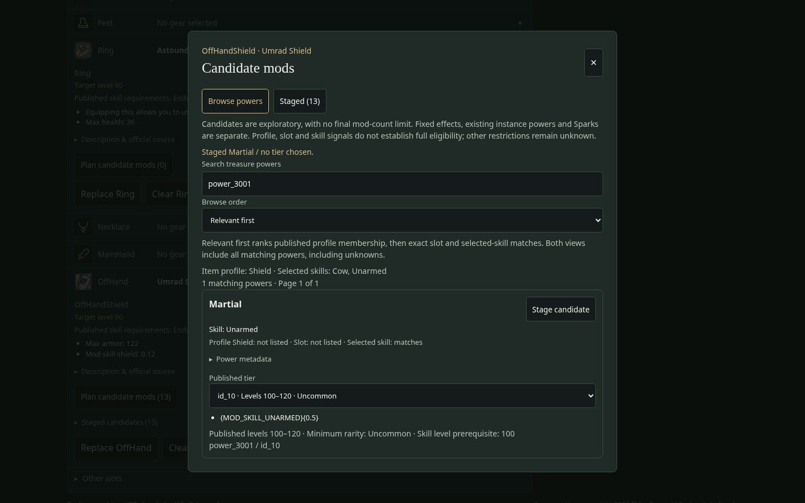
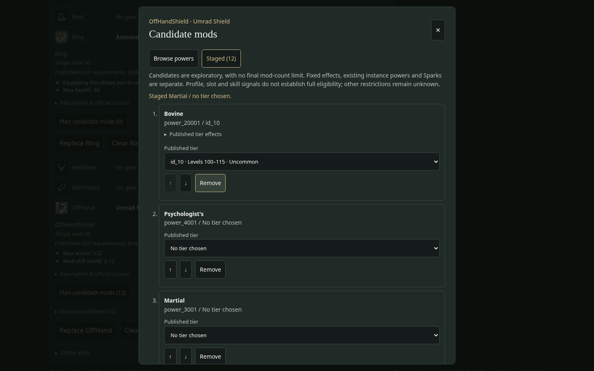

# T0010 — Treasure Mod Planner

**Status: Implemented for architectural review and customer hands-on acceptance; not accepted or merged.**

Branch: `feature/t0010-treasure-mod-planner`, created from latest fetched GitHub `main` at `e0f63933d08ea6744aef8d80d7a798ad26a0187f`. Required repository/design/state/verification documents and existing domain, normalization, repository, equipment, persistence and editor contracts were reviewed before implementation.

## Result

Expanded equipped-item details expose **Plan candidate mods (count)** and a collapsed staged-candidate review. The focused native dialog has Browse powers and Staged views. Existing manual/imported powers are displayed separately, including their exact saved composite IDs and published effects when available. The base item's fixed effects and Spark settings retain their existing display/data.

Search uses a transient index derived from the existing runtime repository's 1,947 official v490 powers and 45,634 power-owned tiers. It supports published prefix/suffix names, internal names, power IDs, tier IDs/text, exact descriptions, and published level/rarity text. Ten results render per page. There are no new dependencies or remote requests per keystroke.

**Relevant first** orders by published item-profile membership, then exact published slot match, then resolved selected-skill match. **All powers (name order)** provides context-independent alphabetical exploration. Both orders include every matching power, including unavailable powers, unsupported AnySkill selectors and unknown metadata. This deliberately uses ranking rather than an eligibility filter. Each result exposes its independent relevance signals, published skill association, availability flag, tier choices, exact selected-tier effects/IDs, levels, minimum rarity and skill-level prerequisite. Expanded metadata includes all published slots/profile memberships, internal/name fields, both availability flags and the official source link. A resolved skill with no published display name shows its official ID, rather than falsely claiming its association is unknown.

Candidates can be staged with a published tier or null, edited, reordered and individually removed. Repeated powers and numerous candidates are permitted. Immutable commands validate each new composite `(powerId, tierId)` against the runtime repository; a display tier number never replaces the source key. Missing saved power/tier records retain their IDs and offer recovery guidance and explicit edit/removal. Missing base definitions and absent/unresolved profiles keep profile relevance unknown.

Schema v1, the existing 500 ms autosave/recovery lifecycle and persistence architecture are unchanged. Candidate edits preserve canonical item slots, fixed definitions, existing instance powers/metadata, Sparks, both skill slots/bars, unrelated equipment and other build fields. Read-only/version-mismatch protections remain effective. Legacy conflicting offhand entries remain intact while editing a specific entry's candidates; ordinary equip/resolution safeguards remain unchanged. X/Escape close the dialog and return focus; moving/removing candidates keeps keyboard focus in the staged list. Equipment picker backdrop behavior is unchanged (KI-0010).

## Files changed

| Files | Purpose |
| --- | --- |
| `src/core/build/candidate-mods.ts` | Pure typed add/tier/move/remove commands and validation |
| `src/app/editor/build-editor.ts` | Minimal immutable candidate edit integration |
| `src/data/search/treasure.ts` | Pure derived text index, independent relevance and deterministic browsing |
| `src/features/mods/{EquipmentMods,ModPlanner,CandidateList,PowerFacts}.tsx` | Compact equipment entry point, dialog, staged list, source/tier/instance facts |
| `src/features/mods/mods.css` | Focused responsive styles |
| `src/features/equipment/EquipmentPlanner.tsx` | Narrow mod-control integration with unique active-skill context |
| `src/data/search/treasure.test.ts` | Official-data search/relevance/unknown tests |
| `src/features/mods/mod-editor.test.ts` | Immutable edits, composite identity, serialization/restore and preservation tests |
| `src/features/mods/ModPlanner.test.tsx` | Actual App workflow, 500 ms autosave, restoration and draft protections |
| `src/features/mods/mods.smoke.py` | Repeatable real-browser dev/preview verification |
| `docs/T0010_Verification.md`, `docs/screenshots/t0010/*.png` | Review evidence and customer checklist |

Official raw/normalized/generated records, loader/integrity, persistence implementations, schema, dependencies, skill/ability features and other equipment behavior were not changed.

## Automated verification

Node 24.19.0; npm 11.9.0. Passed:

```bash
npm ci --cache /tmp/gorgon-npm-cache
npm run data:update -- --check
npm run lint
npm run typecheck
npm test
npm run build
git diff --check
XDG_CONFIG_HOME=/tmp/t0010-wrangler-config npx wrangler deploy --dry-run --outdir /tmp/t0010-wrangler-dry-run
CHROMIUM_TRUST_HOME=/tmp/t0010-chromium-home python src/features/mods/mods.smoke.py --output /workspace/artifacts/t0010/mods
CHROMIUM_TRUST_HOME=/tmp/t0010-chromium-home python src/features/equipment/equipment.smoke.py --output /workspace/artifacts/t0010/equipment
CHROMIUM_TRUST_HOME=/tmp/t0010-chromium-home python src/test/vite-transport.smoke.py --output /workspace/artifacts/t0010/transport
```

**444 passing tests across 18 files**, including **26 new focused tests** (10 search/relevance, 7 editor/persistence, 9 component workflows). Existing exclusive-offhand/legacy-conflict and T0008/T0009 tests pass. Component assertions cover precise official tier text, resolved skills without display names, 12 initially staged candidates, add/remove/move/tier/null edits, exact saved order and canonical slot, independent imported powers/Sparks, protected schemas/storage reads, snapshot mismatch, unresolved records and legacy offhand preservation. The workflow also verifies no save at 499 ms and successful save at 500 ms.

The initial full run lacked localhost permission for the existing transport tests; rerunning with the executor's network permission passed the complete suite. Browser setup uses the installed Chromium/Python Playwright and the environment's public CA in a temporary NSS trust store, with TLS validation enabled. No environment policy or dependency change was needed. Wrangler was a dry-run only.

All 13 pinned raw datasets validated offline. No official data regeneration was performed.

## Real-browser verification

Chromium 154.0.8037.57 ran actual Vite dev and production preview at 1440×900 and 375×812. The new workflow:

- Selected Cow/Unarmed skills and both ability bars, then equipped Head, Ring and canonical OffHandShield gear.
- Observed different profile-aware ordering on different items and searched Psychology, Cow and Unarmed in all-power order.
- Selected exact `id_10` tier effects, staged 13 candidates, changed a tier to `id_12`, moved/removed candidates, cleared a tier to null, and restored the remaining 12 in exact order after reload.
- Compared the full restored build with the original except for the intended candidate array; both bars, other gear, skill levels and canonical slot were preserved.
- Seeded imported existing powers, instance metadata, Sparks and an unknown saved candidate, then verified preservation through another candidate tier edit.
- Inspected a version-mismatched draft and verified every candidate mutation control disabled and stored bytes unchanged after the autosave interval.
- Used keyboard Enter/Escape, checked focus return and focus following a moved row, inspected literal published `<icon=108>` prose as text, and checked desktop/mobile dialog and page overflow.

Both modes produced zero unexpected console errors or page exceptions. Screenshots below were visually inspected. Raw screenshots, measurements and JSON reports remain in `/workspace/artifacts/t0010/`.

The unchanged equipment browser smoke also passed canonical weapon/shield swaps and reloads, compact details, legacy conflict cancel/confirmed resolution, imported replacement confirmation, candidate/Spark preservation, search drag/backdrop retention, target-level preferences, icon fallback, keyboard and mobile checks. Its deliberate icon-404 case recorded only the expected resource message. The transport smoke passed compressed byte counts/hashes and headers for all three artifacts, all corruption/retry cases and the Psychology/Deer, Cow/Unarmed, duplicate-skill and one-skill workflows in both modes.

Observed dev/preview initial loads were 1,112/1,213 ms. Production-preview search interaction round trips were 29–87 ms and dialog opens 163–238 ms with the complete v490 dataset. Heap after forced GC was approximately 74 MB initially and 90 MB with the staged mod dialog open (dev: 78/98 MB). These include browser automation/rendering and are local observations, not pure-filter benchmarks or device guarantees. KI-0009 remains open for representative-hardware monitoring.

## Screenshots





[Mobile power browsing](screenshots/t0010/browse-mobile.png) · [Mobile staged candidates](screenshots/t0010/staged-mobile.png)

## Customer acceptance checklist

1. Equip Head, Ring and an offhand weapon/shield or other different gear. Set two skills and populate both bars.
2. Expand each equipped item's details and open **Plan candidate mods**. Search Psychology, Cow and Unarmed; inspect selected tiers and metadata.
3. Compare **Relevant first** with **All powers (name order)** and compare different items. Check that profile membership and unknown associations are understandable without implying full legality.
4. Stage more candidates than a finished item would normally contain, including a candidate with no tier selected.
5. Open **Staged**, change tiers, move candidates up/down and remove one. Check exact IDs and published descriptions.
6. Close the dialog, review the collapsed staged-candidate section, wait for Saved, then refresh. Verify exact candidate order, tier IDs/nulls and equipped item's canonical slot.
7. Confirm both skill bars, skill levels, other equipment, existing instance powers and Spark settings were preserved.
8. Repeat common actions by keyboard and on a narrow mobile viewport. Check Escape/X, focus return and readable controls without horizontal overflow.

Architectural review and customer acceptance remain pending. Do not merge or mark T0010 complete based solely on this report.

## Risks, assumptions and follow-ups

- Published profile membership and slot/skill matches are independent facts, not a full legality check. AnySkill, missing skill associations and unsupported restrictions remain unknown. Availability flags are displayed without preventing exploratory staging.
- Raw effect tokens/prose remain exact, uninterpreted text. No numeric damage/eligibility rules, mod-count limits, Spark editing, imports or future-ticket features are added.
- Browser measurements are unthrottled local Chromium observations, not a guarantee for low-end devices, other engines or the deployed Cloudflare runtime. KI-0009 memory/load monitoring and optional KI-0010 backdrop dismissal remain separate follow-ups; no new unrelated issue was implemented.
- After acceptance/merge, synchronize Tickets, Repo_Current_State, MVP technical notes and Manual_Verification_Guide with the accepted T0010 behavior. Their completion status is intentionally unchanged in this PR.
