# T0010 — Treasure Mod Planner: final customer UI corrections

**Status: Customer-accepted and squash-merged into `main` on 2026-11-01 via [PR #22](https://github.com/Zaelious/GorgonBuilder/pull/22), merge commit `385e4b96b52e53d4f8d7db5cc5455a9148ed1ef2`. Final reviewed PR head: `510d663`. GitHub Actions completed successfully with 513 passing tests in 24 files; Cloudflare preview build passed.**

Branch: `feature/t0010-treasure-mod-planner`. The initial implementation at `62d8116` passed architectural review, but the Product Owner requested a different UI in [the latest customer revision review](https://github.com/Zaelious/GorgonBuilder/pull/22#pullrequestreview-5729510750). The subsequent [rendering/density review at c13d9f5](https://github.com/Zaelious/GorgonBuilder/pull/22#pullrequestreview-5729721042) requires actual official icons, readable effects and substantially denser lists. The [customer acceptance review at 8f6f4a2](https://github.com/Zaelious/GorgonBuilder/pull/22#pullrequestreview-5729847590) then required four further corrections: player-facing percentages, unclipped mod effects, use of the desktop viewport and visible three-digit skill levels. The [acceptance review at 63dd16e](https://github.com/Zaelious/GorgonBuilder/pull/22#pullrequestreview-5730658550) then reported three remaining issues: MainHand Druid mods, Acid Arrow Relevant Mods and popover clarity. They are described first below. Before that, the [ability-details addendum at 68e2fa7](https://github.com/Zaelious/GorgonBuilder/pull/22#pullrequestreview-5730552251) then asked for visible ability facts and a Relevant Mods section, described first below. Before that, the [architectural re-review at dd781c0](https://github.com/Zaelious/GorgonBuilder/pull/22#pullrequestreview-5730438882) then asked for two visual fixes: slot-based skill colours and grouped STATS rows, described first below. Before that, the [final customer review](https://github.com/Zaelious/GorgonBuilder/pull/22#pullrequestreview-5730246516) and its [addendum](https://github.com/Zaelious/GorgonBuilder/pull/22#pullrequestreview-5730252983) then required six more corrections, described in the first section below. Later sections keep the earlier evidence, marked where this revision supersedes it. Existing domain/persistence work remains in place.

## MainHand Druid mods, Acid Arrow matching and a compact popover (review at 63dd16e)

### 1. Druid mods missing on MainHand: root cause and fix
- **Root cause (verified in v490 data):** Druid publishes **12** MainHand powers, but they belong only to the `Staff`, `Club`, `Lute`, `MeleeStaff`, `FireStaff`, `FireStaffBeaker` and `All` profiles. MainHand items with profile `Sword` (58 items), `Dagger` (49), `Hammer` (33), `FistWeapon` (29), `Beaker` (17), `Rapier`, `IceDagger` or `StaffBeaker` list **0** of them.
  - The previous `fitsItem` excluded any power whose profile was `different`, so Druid disappeared on those items.
  - Archery's 13 MainHand powers are listed by every MainHand profile except `NewbSword` and `Rapier`, which is why only Archery appeared.
- **Profile is not proof of ineligibility.** The official notes describe a TSysProfile as the pool an item is *randomly generated* with.
- **New rule:** `itemFit` classifies each power as one of:
  - **listed:** slot match, plus profile match or unknown profile.
  - **outside profile:** slot match, but the item's profile doesn't list it.
  - **other slot:** shown only while exploring.
- **Normal list:** shows listed powers, plus **outside-profile powers of the active combat skills (A or B)**.
  - Each outside-profile row carries a dashed **outside profile** flag. Its tooltip reads "Not listed in this item's published treasure profile (Sword). Equipment eligibility unconfirmed."
  - The group heading adds e.g. **"12 outside item profile"**.
  - Generic, Unknown and non-active skills stay strict, so no clutter returns.
- **Slots stay strict.** Druid + Chest still lists exactly the **11** listed powers, with Max/100 unchanged.
- **Examples:**
  - Marvelous Military Sword (`item_46107`, Sword profile): Druid 12 flagged + Archery 13 listed.
  - Marvelous Priest Staff (`item_47152`, Staff profile): Druid 12 + Archery 13, all listed.
  - Shield (`item_45052`): Archery's OffHand powers now appear, all flagged, because the Shield profile lists no Archery powers.

### 2. Acid Arrow Damage +110% missing: root cause and fix
- **Data:** `AcidArrowBoost` is `power_10302` (MainHand/Legs). Its max tier `id_25` publishes `{MOD_ABILITY_ACIDARROW}{1.1}` → **Acid Arrow Damage +110%** (label "Acid Arrow Damage %", AsBuffMod).
- **The rank hooks were not the problem.** Every Acid Arrow rank (`ability_2571` … `ability_2627` Acid Arrow 13, family `AcidArrow1`) publishes `MOD_ABILITY_ACIDARROW` in `AttributesThatModDamage`.
- **The real exclusion reason:** 14 families reference the attribute. Besides `AcidArrow1` and `OrcAcidArrow1`, there are 12 internal treasure-proc abilities, `TSysBonusAcidCloud1–12` (`InternalAbility: true`, skill `Unknown`, no `UpgradeOf`). That pushed the count over the ≤3 family threshold.
- **Fix (narrow, source-evidenced):**
  - **Hooks:** attribute templates now check the **union of hooks across the whole family** (all ranks).
  - **Label fallback:** an attribute also matches when its **official attributes.json label names the family as a whole phrase**. Families whose name is also an official skill name are excluded (e.g. `FIRSTAID_COST_MOD` "First Aid Ability Power Cost %").
  - **Why labels:** the runtime data doesn't keep `InternalAbility` or the attribute `IconIds`, so the label is the evidence available without regenerating game data.
  - **What it adds across v490:** exactly 9 single-ability attributes, namely Acid Arrow, Flamestrike (Boost/Mod), Mark Weakness (Boost/Mod), Mindworm (Boost/Mod), Song of Discord and Stake the Heart.
  - **Still not attributed to one ability:** skill-wide or group labels such as "Crossbow Damage" and "All Shield Bash Abilities".
- **Prose fallback:** `AcidArrowDoT` ("Acid Arrow deals 465 Poison damage after a 6-second delay") is published with Poison Arrow's icon (3301), so the icon + name rule missed it.
  - When **no** family matches by icon + name, a description that **begins with exactly one family's full name** now matches that family.
  - Across v490 this adds 9 correct matches: AcidArrowDoT, Shield Team ×2 and Fill With Bile ×7.
  - It deliberately does not match the generic "Bite attacks…" (20 families named Bite). "Pound to Slag"/"Rib Shatter" mods do not leak to "Pound"/"Rib", because those already match their own family by icon.
- **Acid Arrow 13 now matches:**
  - **Included:** AcidArrowBoost (+110%), ElementalArrowBoost (Fire/Poison/Acid Arrow +50%), AcidArrowMeltArmor, AcidArrowReduceRage, AcidArrowDoT, and FireArrowFaster ("Acid Arrow and Poison Arrow hasten…").
  - **Not included:** general Archery (`MOD_SKILL_ARCHERY`), projectile-wide, ArcheryBoostPoisonAndAcid, ArcheryCritAcidBomb and Fire-only mods.
  - **Brambleskin:** unchanged at exactly 8 powers for every rank.

### 3. Compact ability popover
- **Order:**
  1. Icon, name, rank and description (compact 0.8rem).
  2. An **aligned two-column stats grid**: Min level, Power cost, Reuse, Range, Damage (e.g. `529 Acid`), plus Health damage, Armor damage and If vulnerable when published.
  3. **Relevant Mods directly beneath the stats.**
  4. **Ability effects**, only when meaningful.
  5. Technical details.
- **Ability effects** lists only non-zero published entries, in plain wording without enums, e.g. Brambleskin: "Melee Damagers Suffer 310 Nature damage". Multi-tick DoTs read "… damage per tick × N over D s". `SpecialInfo` and non-zero special values are shown as published.
- **Zero-value or conditional DoT records** (Acid Arrow's `0 Poison … BuffActivated, DelayedDamage` and `On Critical Hit: 0 Poison …`) are **not** shown as damage. They stay with exact values under **Technical details**, next to ID, internal name, rank, CritDamageMod and keywords, under the heading "Published PvE records (source conditions not interpreted)". No source data is deleted, and there is no claim that the triggers never apply.
- **Sizing:**
  - **Width:** the desktop popover is **440px** (was 360), constrained to the viewport minus 32px.
  - **Narrow screens:** the stats grid collapses to one column below 26rem.
  - **Unchanged:** existing overflow-safe positioning, hover/focus/click/Escape behaviour and touch targets.
  - **Disclosure marker:** Technical details shows a ▸/▾ marker at every width.

### Tests and browser evidence
- **Pure tests:**
  - Druid + Archery on the Sword (Druid 12 outside-profile, Archery 13 listed) and the Staff (both listed). A/B swap, no skills, no duplicates, Generic and non-active skills strict, Druid Chest still 11, and exploring shows other-slot powers.
  - Acid Arrow's 13 ranks match +110% despite the 14-family count. The Acid Arrow 13 set includes and excludes the powers listed above, and First Aid is not label-scoped.
  - Prose fallback boundaries and Brambleskin unchanged.
  - Ability-effect formatting: zero-value DoTs move to technical records with exact values, plain DoT wording, and no enums in player effects.
- **App tests:**
  - Druid + Archery MainHand Sword: 12 flagged Druid rows with the Sword tooltip, 13 unflagged Archery rows, and staging a flagged Druid power works and saves its exact ID.
  - Acid Arrow 13: stage +110% on MainHand; compact stats (`Damage 529 Acid`, `Armor damage 529 Acid`); Relevant Mods directly after the stats showing "Acid Arrow Damage +110% · MainHand" (`power_10302`/`id_25`); no visible zero DoTs or enums; exact technical records; removal shows the empty state and saves.
  - Brambleskin: the Ability effects wording and Relevant Mods placement.
- **Chromium smoke (dev and production preview, zero unexpected errors):**
  - The Shield's Archery rows are all flagged.
  - MainHand Sword shows Druid 12 flagged (with the heading count) and Archery 13 listed.
  - Staging +110% shows it under Acid Arrow 13 (MainHand) with no zero-DoT text; the popover is 440px with Relevant Mods fully visible.
  - Removal updates the popover immediately, and re-staging works.
  - At 375px and 320px the popover stays inside the viewport with no overflow.
  - The Brambleskin, Druid Chest and earlier stages still pass.
- **Screenshots:** `acid-arrow-popover-desktop.png`, `acid-arrow-popover-mobile.png`, `mainhand-druid-archery.png`; the other captures were refreshed.
- **Totals:** 513 tests across 24 files; the equipment, transport and layout smokes also passed.

## Ability details and Relevant Mods (addendum at 68e2fa7)

### Ability facts shown immediately
- The "More details" dropdown is removed from `AbilityFacts`. The full description and the core stats (Min Level, Power, Reuse, Range, Base damage) are always visible. AoE, health damage, armor damage and extra damage if vulnerable are also shown whenever the source publishes them.
- A new **Ability effects** list shows `SpecialInfo`, the PvE special values and the DoTs as published. For example, Brambleskin 13 shows **Melee Damagers Suffer 310 Nature per tick · 1 tick · DelayedDamage**. Nothing is calculated or inferred, and "Not published" stays as is.
- Only technical fields sit under an optional, closed **Technical details** section: official ID, internal name, raw rank, keywords and a provenance note.
- The same component serves the ability picker's tier facts, so the picker benefits too.

### Relevant Mods
- Every ability popover has an always-visible **Relevant Mods** block: an uppercase blue heading, a left accent border, a light blue tint and divided rows. It is not an accordion.
- **Sources:** only equipped gear in the current build, covering both imported `existingPowers` and planned `candidateMods` whose exact `(powerId, tierId)` resolves.
- **Order:** stable. Equipment order first, then imported before planned, then saved order.
- Rows use the shared `EffectDescriptions` renderer, so they show official icons and formatted text. A small source label shows the slot (with "◇ imported" for imported powers); the tooltip has the item name, IDs and the match reason.
- **Duplicates are kept.** The same effect on two different items gives two rows.
- **Unresolved saved IDs** are skipped in this section, never removed from the draft.
- If nothing matches, the section says "No ability-specific equipped mods identified."
- The list is computed on render from the current build, so it updates immediately when mods are added, removed or re-tiered, when gear or the ability changes, after a skill change and after Undo. Nothing new is persisted.

### Matching rules (`src/data/search/ability-mods.ts`, pure and cached once per repository)
The family is the official `UpgradeOf` root, so every Brambleskin rank shares one family.

**Attribute templates** `{ATTR}{value}` match when both conditions hold:
1. `ATTR` appears in the ability's published `AttributesThat*` hooks (ability, PvE, DoT or special-value level).
2. At most **3** ability families reference `ATTR`.

In v490, of the treasure attributes that some ability references, 240 are referenced by one family, 16 by two and 2 by three. From four families up they are skill-wide, e.g. Crossbow and Cow base damage, `MOD_SKILL_DRUID` (22 families) and `ABILITY_RESETTIME_DELTA` (1,935). Skill-wide attributes are deliberately **not** labelled as specific to one ability. That also excludes the 5-family "All Shield Bash Abilities Damage", a conservative and documented exclusion.

**Prose effects** match only when both conditions hold:
1. The text contains an official `<icon=N>` equal to an `IconID` used by the family (Brambleskin uses 3483).
2. The family's root display name appears as a whole phrase (case-insensitive; apostrophes ignored).

Results on the v490 data:
- **Coverage:** 1,095 of 1,320 icon-bearing prose effects (top tiers) match some family.
- **Misses:** mostly skill-wide wording such as "All Sword abilities…" or "Archery attacks that…". These are correctly treated as not ability-specific, plus a few naming variants that are not matched rather than guessed.
- **Brambleskin:** every Brambleskin rank, including Brambleskin 13, matches exactly the **8 official Brambleskin powers** (`power_14151`–`power_14157` and `power_14159`). Unrelated Druid mods such as Indirect Poison and the skill-wide Druid Base Damage are excluded.

**Tests:**
- **Pure:**
  - The exact Brambleskin set for ranks 13 and 1.
  - Attribute matches and skill-wide exclusions.
  - Prose needs both the icon and the name.
  - Duplicates kept, equipment order, unresolved IDs skipped.
- **App:**
  - Brambleskin 13: effects and the visible section.
  - Rows: imported Head plus two planned Chest rows, with identical effects separate and official icon 3483 loaded.
  - Nonmatching and skill-wide mods excluded, and no write to the draft.
  - Immediate updates on removal and tier change, and the empty state.
- **App.test:** the full description is shown, and the ID appears only inside the closed Technical details.
- **Chromium smoke (dev and preview):**
  - Opens Brambleskin 13: three rows in the expected order, identical effects present, icon loaded.
  - Closes with Escape, then removing a planned mod updates the section to two rows.
  - At 375px the popover fits the viewport with no overflow.
  - Desktop and mobile captures (`relevant-mods-desktop.png`, `relevant-mods-mobile.png`).

**Limitations:**
- Effects that apply to a whole skill or to multiple ability groups are not listed per ability.
- Relevant Mods does not imply an effect is active, legal or stackable.
- No damage is recalculated.

## Slot colours and grouped STATS rows (re-review at dd781c0)

### 1. Skill A blue, Skill B gold
- The hashed palette (`categoryHue`) is removed. A planned or imported power's tone now comes from its **officially resolved skill ID**, compared with the build's current Skill A and Skill B. The two slot IDs are passed to `ItemStats` in order, not as a deduplicated set.
- **Skill A** is filled blue: `#1a5fc0` with white text, 6.1:1 contrast. **Skill B** is filled gold: `#f2c230` with near-black text, 10.9:1. These values come from computed styles checked in Chromium.
- **A=B** uses the single Skill A blue. When the skills swap slots, the colours follow the new assignment, because nothing is stored.
- The chip text always names the skill (e.g. DRUID, ARCHERY), so colour is never the only cue. The STATS legend shows `A · Druid` and `B · Archery` in the slot colours.
- **Generic** (slate), **Endurance** (brown) and **Shamanic** (teal) each use a muted fill with at least 7:1 contrast. Resolved skills in neither slot are neutral gray, and unknown or missing powers get a dashed neutral chip, so none of these looks like a combat slot.
- **Base** rows stay neutral. **Imported** powers keep their outlined, dashed style but use their slot tone, e.g. `◇ ARCHERY` outlined in blue when Archery is Skill A.

### 2. Planned STATS rows grouped by skill (presentation only)
- `groupPlannedMods` sorts a copy of the planned mods in this order: Skill A, Skill B, Generic, Endurance, Shamanic, other resolved skills (by first appearance), then Unknown. Order within each group is unchanged.
- Base fixed effects stay first and complete. Imported powers follow, then the grouped planned mods.
- Adding Druid 1 → Archery 1 → Druid 2 shows **DRUID, DRUID, ARCHERY**. `data-candidate-effect` keeps the original saved indices (`0, 2, 1`).
- `BuildDocument.candidateMods`, the exact `(powerId, tierId)` pairs, the Selected pane order and its up/down/remove/tier controls are unchanged. The saved draft keeps Druid, Archery, Druid.
- Grouping stays correct after removing a candidate by its saved index, after reload, after a skill change clears the departed skill's mods, and after Undo.
- **Tests:**
  - Pure tests cover every tone, the A/B swap, A=B, no slots, and the full group order including missing and unknown powers. They also check that the input array is not mutated.
  - A component test checks A/B swapping, A=B, imported tones and original indices.
  - An App test covers Druid → Archery → Druid: STATS order, tones and legend; Selected order; exact saved order through autosave; removal; and reload.
- The **Chromium smoke** (dev and preview) asserts:
  - STATS order and the original indices.
  - Computed chip backgrounds of `rgb(26, 95, 192)` for Druid and `rgb(242, 194, 48)` for Archery.
  - Druid → Psychology clears 2 Druid mods, keeps the gold Archery row, and Undo restores everything.

Files: `src/data/search/treasure-planning.ts` (`skillTone`, `groupPlannedMods`), `src/features/mods/ItemStats.tsx`, `item-stats.css`, `src/features/equipment/EquipmentPlanner.tsx`, `src/features/mods/ItemStats.test.tsx` (new), `treasure-planning.test.ts`, `ModPlanner.test.tsx` and `mods.smoke.py`. Screenshots were refreshed. **500 tests across 21 files pass.**

## Final customer UI corrections (reviews at d8f195a)

### Why repeated Druid entries appeared, and the grouping key

The pinned v490 `tsysclientinfo.json` publishes **65 Druid powers**. The previous Available list showed every power associated with an active skill, ranked by slot/profile relevance but never filtered by them. Each row already showed only one tier per power, so the "repeats" were **distinct power IDs meant for other slots**. Same-effect variants such as `BrambleSkinMaxArmorBoost` (OffHand) and `BrambleSkinMaxArmorBoostB` (Chest), or `BrambleSkinMaxHealthBoost` (Legs) and `…B` (Necklace), were listed side by side.

**Exactly 11 Druid powers publish `Chest` in `Slots`**, and all 11 are members of the `All` profile used by ordinary Chest armor. That matches the GorgonExplorer reference count, so nothing is hard-coded:

`power_14005` DruidBoostIndirectPoison · `power_14012` HeartThornNatureDoT · `power_14051` RotskinDamageBoost · `power_14052` RotskinDoT · `power_14101` DeleriumDamageBoost · `power_14154` BrambleSkinMaxArmorBoostB · `power_14159` BrambleSkinMod · `power_14201` CosmicStrikeDamage · `power_14351` RegrowthHealing · `power_14501` CloudSightInsects · `power_14602` HealingSanctuaryArmor.

The grouping key is the **official power ID**: one Available row per power, whose tiers are its level variants. A power is listed normally when:
1. its published `Slots` include the item's slot; and
2. where the item publishes a resolved `TSysProfile`, that profile (`tsysprofiles.json`) lists the power.

Slot evidence:
- **One evidenced alias:** `OffHandShield` items (profile `Shield`) use the `OffHand` treasure slot. All 325 `Shield`-profile powers publish `OffHand`.
- **Unknown signals never exclude.** If there is no item definition, the power publishes no slots, or the item has no profile, the signal is treated as unknown.

Category evidence:
- **Endurance and Shamanic Infusions use slot only.** Their powers belong only to the `Redwall`, `Brewing` and `Shamanic` profiles, and no v490 item references those profiles. Profile filtering would hide them for every item.
- **Druid + `item_42705` (Fae Soldier Jumpsuit, Chest, profile `All`) groups:** Druid **11**, Generic **19**, Endurance **6**, Shamanic Infusions **4** (`power_30101`–`power_30104`).

Same-effect checks across the data:
- **Skill groups:** after slot/profile filtering, no two powers in any skill group share a number-stripped effect template.
- **Generic (AnySkill):** a few same-attribute pairs remain, e.g. `PowerBoostVeryWeak` (tiers 0–170) vs `ShoddyPowerBoost` (0–150), and `InventoryBoostVeryWeak` vs `InventorySlotBoost`. These are separate official records with different tier tables, so they are **kept as distinct entries**, never merged by text similarity.
- **Exploration:** "Other slots & profiles" turns filtering off and shows all 65 Druid powers. "All skills" still adds other skills' groups.

**Max / 100:** at Max each row previews its highest published minimum-level tier. Entering 100 changes only each row's preview tier/effect, so Druid + Chest stays at 11 rows. Example: `power_14005` is `id_25` **Indirect Poison Damage +58%** at Max, and a tier whose published range contains 100 at target 100. Other tiers remain under ⋯ Details.

### Mutually exclusive Available / Selected

- Available excludes any power already staged on that item (any tier, including null).
- Clicking an Available row stages its exact displayed `(powerId, tierId)`. The row disappears and the effect appears in Selected and in STATS immediately. Removing it from Selected restores the row at the current target preview.
- New adds carry `unique: true`. The pure edit returns the unchanged document if the power is already staged, so a double click or a stale handler can never create a copy.
- Target changes never re-add or rewrite staged powers; the mismatch flag remains.
- Legacy drafts with duplicate entries keep every saved entry, each with its own edit/remove control. The power returns to Available only after its last entry is removed. There is still no count limit.

### Skill changes clear the departed skill's staged mods

- A `skill` edit computes the **departed** skill: the slot's previous skill, but only if the other slot isn't using it.
- In the same immutable edit (one document and one autosave), every equipment entry drops staged candidates whose power has an **officially resolved** association with that skill. Other equipment entries keep their object identity.
- Kept: Generic/AnySkill, Endurance, Shamanic Infusions, unresolved or unknown associations, unknown power IDs, imported/manual existing powers, fixed effects, Sparks, other skills' mods, the other slot/bar, equipment and all unrelated fields.
- A=B=Druid: clearing one slot keeps Druid mods; clearing the last Druid slot removes them. Druid → Psychology removes Druid mods and keeps the rest.
- The skills panel shows **"Removed N staged Druid mods from M items."** with an **Undo** button (restores the exact previous document, including the skill and bar) and a dismiss button. The notice is a polite live region and retires on the next edit. Read-only and version-mismatch drafts cannot change.

### STATS panel and fixed effects

- Each equipped item has one compact **STATS** panel: all published fixed effects (chip **Base**), then imported existing powers (dashed chip **◇ Skill**), then planned mods (filled chip **Skill**).
- Every row is a two-column grid with a fixed chip column, so effects start at one aligned x position (asserted in Chromium). *Superseded:* chip colours are now slot-based (Skill A blue, Skill B gold; see the first section).
- Official icons and complete, unclamped descriptions are kept. The word **CANDIDATE** and the loose list are gone; a small legend explains Base / ◇ Imported / Planned.
- `ItemFacts.tsx` no longer cuts fixed effects at three behind a "more fixed effects" dropdown. **All** published fixed effects are shown immediately: 1,247 v490 equipment items have more than three, up to nine. **Description & official source** remains an optional expandable section, and it still lists the exact raw fixed-effect strings.

### Readable fixed item effects (source format inspected first)

Equipment `EffectDescs` in `items.json` contain 8,460 lines:
- **8,248 `{ATTRIBUTE}{value}` templates**, only the two-argument form, with no required skill.
- **212 prose lines.**
- No unknown attributes and no `DisplayRule: Never` attributes.

The format matches the treasure-tier template, so the **shared** `presentEffect` formatter is reused. One extra type appears in fixed effects: **AsBool** (40 lines, every value `1`), now shown as e.g. **Signature Support abilities work while stunned: Yes**.

Examples:

| Published | Shown |
| --- | --- |
| `{VULN_ELECTRICITY}{-0.2}` (AsDebuffMod) | **Vulnerability to Electricity -20%** |
| `{VULN_NATURE}{-0.1}` | **Vulnerability to Nature -10%** |
| `{MAX_ARMOR}{120}` (AsInt) | **Max Armor +120** |
| `{MAX_HEALTH}{37}` (AsInt; formatter test, no item publishes 37) | **Max Health +37** |
| `{COMBAT_REFRESH_ARMOR_DELTA}{45}` (AsBuffDelta) | **Armor from Combat Refresh Abilities +45** (the official label; the review's "Combat Refresh Armor" was shorthand) |
| `{FALLING_DAMAGE_MOD}{-0.1}` (AsPercent) | **Falling Damage -10%** |

A test formats every published fixed effect and checks that none produces a raw token, `NaN` or a required skill.

**Confidence (addresses the architectural note on inferred conversions):** the internal `verified` boolean is replaced by `confidence`:
- **confirmed:** AsBuffMod and AsPercent (player-facing references), AsDebuffMod (now matched to the Product Owner's `-0.2 → -20%` example), and signed additive types.
- **inferred:** `%`-labelled AsDoubleTimes100 and AsBool. The value carries a `data-confidence` attribute and a tooltip saying it is inferred from the official type and not yet matched against the game.
- **unverified:** shown with the visible "(scale unverified)" flag.

## Earlier customer acceptance corrections (review at 8f6f4a2)

### 1. Player-facing attribute formatting (source evidence)

The official v490 data notes in the pinned `src/data/raw/cache/v490/index.html` (section `tsysclientinfo.json`) define attribute descriptions as **`{attributeName}{delta}{requiredSkill}`**: the second value is a *delta* to the attribute in `attributes.json`, and the optional third value is a skill that **"the player must have active to get the buff."** The pinned `attributes.json` gives each attribute a `Label` and `DisplayType`.

In the 20,649 template lines across all 45,634 pinned tiers, the labels split exactly by display type:

| DisplayType | Template lines | Label ends in `%` | Presentation now used |
| --- | --- | --- | --- |
| AsBuffMod | 7,880 | all | delta × 100, signed, `%` |
| AsPercent | 1,791 | all | delta × 100, signed, `%` |
| AsDebuffMod | 28 | all | delta × 100, signed, `%` |
| AsDoubleTimes100 | 71 / 19 | 71 yes / 19 no | `%` labels: delta × 100, signed, `%`; non-`%` labels: unchanged value + **(scale unverified)** |
| AsBuffDelta, AsDebuffDelta, AsInt, AsDouble | 7,974 / 707 / 1,831 / 348 | none | signed delta, unchanged (`Max Health +37`, `Ice Spear Power Cost -3`) |

How strong the evidence is for each type:

- **AsBuffMod: confirmed by player-facing references.** The pinned tiers `power_12192/id_25` = `{MOD_ELECTRICITY_DIRECT}{0.25}{AnimalHandling}`, `{MOD_FIRE}{0.25}{AnimalHandling}` and `power_12194/id_25` = `{MOD_PSYCHIC}{0.23}{AnimalHandling}`, `{MOD_CRUSHING_DIRECT}{0.23}{AnimalHandling}` appear in the customer's GorgonExplorer reference and on [GorgonCodex Animal Handling](https://www.gorgoncodex.com/guides/skills/animalhandling) as +25%/+25% and +23%/+23%. [GorgonCodex Archery](https://www.gorgoncodex.com/guides/skills/archery) also shows the pinned `ArcheryBoost id_12` (`{MOD_SKILL_ARCHERY}{0.6}`) as **Archery Base Damage +60%**, `HeavyShotBoost id_25` (`0.625`) as **+62.5%**, `AimedShotBoost id_25` (`0.6`) as **+60%** and `LongShotBoost id_25` (`0.91`) as **+91%**.
- **AsPercent: confirmed.** The same Archery reference shows the pinned `{DELTA_ANATOMY_CRITICAL_CHANCE}{0.04}` as **Anatomy-Based Critical Hit Chance +4%**.
- *Updated in the final revision:* AsDebuffMod is now treated as confirmed by the Product Owner's fixed-effect example (`-0.2 → -20%`). AsDoubleTimes100 remains inferred and is marked as such in the UI.
- **AsDebuffMod and `%`-labelled AsDoubleTimes100 (as originally assessed): inferred from official structure, not independently confirmed.** AsDebuffMod attributes have the same multiplier encoding as AsBuffMod (`DefaultValue: 1`, `%` label, fractional deltas, e.g. `VULN_NATURE -0.18`). AsDoubleTimes100 names its ×100 display in the type itself, and the converted attributes carry `%` labels (e.g. `ACCURACY_BOOST_RANGED 0.08`, shown as +8%). No third-party page was found that renders these particular tiers. Together they cover 99 of 20,649 template lines.
- Third-party pages corroborate the result only. They are not imported or used as a data source; the conversion rule lives in `src/features/mods/effect-description.ts` and is keyed on the official DisplayType and Label alone.

Conversion uses exact decimal-string shifting rather than floating point (`0.035 → 3.5`, `0.625 → 62.5`, `-0.01 → -1`, `12.5 → 1250`). Signs are kept (`+`/`-`). A test checks that every pinned template formats without `NaN` or raw tokens, and that only `%`-labelled attributes become percentages. Delta/int/double types are never multiplied. Malformed or unknown templates keep the explicit **unformatted official effect** fallback. No stacking, baseline or damage formula is implied, and saved IDs and source strings are never changed.

**Multiple attributes in one tier are one effect.** All template lines of a tier are shown together, comma-separated: **Direct Electricity Damage +25%, Fire Damage (Direct & Per-Tick) +25%** and **Psychic Damage (Direct & Per-Tick) +23%, Direct Crushing Damage +23%**. This applies to Available, Selected, item CANDIDATE lines, existing powers and tier details. If some lines in a tier cannot be formatted, the supported lines still show, followed by a single fallback marker.

**The required active skill is a subtle note.** The old `· context: Animal Handling` text is gone. The third argument now appears as **Requires Animal Handling active** in the effect tooltip and as an italic note in expanded tier details. It does not take space in the row.

### 2. Full-width desktop planner

- `.app-shell` is `min(100% − clamp(2rem, 4vw, 4rem), 100rem)`, i.e. 16–32px gutters per side and up to **1600px** (previously 75rem/1200px).
- `.skills-section` and `.equipment-section` are `width: 100%` (previously capped at 52rem/832px).
- Measured in Chromium at 100% zoom: both sections are **1382px at 1440**, **1600px at 1920** and **1600px at 2560**. The Available column grows from about 400px to **672px at 1440**. Skill rows keep their height (70–95px) and control alignment (centers within 2px), with no horizontal overflow. Mobile 320/375px still stacks.
- 80% zoom is checked only as a secondary regression (1800 CSS px at 0.8 DPR): no overflow, and levels still fit.

### 3. Mod effects are no longer clipped

- The single-line `nowrap`/ellipsis rule is removed. Effects in Available, Selected and item CANDIDATE lines wrap naturally, with a **two-line clamp** only for genuinely long effects. Expanding **⋯** removes the clamp, and every effect line has a tooltip with the full plain text plus any required-skill note.
- Selected rows use margins instead of padding around the clamped text, so a third line can never peek through, including on 44px touch rows.
- At 1440px and 100% zoom, the paired +25%/+25% effect is **fully visible without ⋯** in Available, Selected and the item CANDIDATE line (asserted by `scrollHeight ≤ clientHeight` and `scrollWidth ≤ clientWidth` in dev and preview). A geometry check confirms that **+**, **⋯** and **×** never overlap effect text.
- The lists stay dense: 420px panes show **11 complete rows** at 1440px, with one-line rows 30–31px and two-line rows 49px. Only 3 of 255 Animal Handling Available rows needed the clamp. Available and Selected still scroll independently.

### 4. Three-digit skill levels

`.planner-main .skill-level input` is now 5rem wide with reduced horizontal padding (previously 3.5rem with 0.65rem padding). Native number input, validation, spin controls and stored values are unchanged. Chromium checks levels **90, 100, 110 and 125** in both skill slots at 1440, 1920 and 2560px at 100% zoom. Using the input's actual font, each value measures 20–27px against 50.8px of text room after padding and a 16px allowance for spin controls. Both levels persist as 125. `125` also fits at 375px, at 320px (within the viewport) and at 80% zoom.

## Earlier rendering/density corrections (still in place, updated)

A shared presentation-only renderer, `EffectDescription` / `EffectDescriptions`, now serves Available effects, Selected candidates, item CANDIDATE lines, saved existing powers, published tier details and alternative-tier buttons. It creates React text/image nodes; it never parses source text as HTML or uses `dangerouslySetInnerHTML`.

- Exact `<icon=NUMBER>` markers produce **18×18 actual images** through the existing validated versioned official icon route, e.g. `https://cdn.projectgorgon.com/v490/icons/icon_2160.png`. Text before/after icons and multiple icons are preserved. Malformed IDs/versions make no image request; failed images get a labelled local placeholder. Unknown HTML remains inert literal React text. Raw icon markers are absent from ordinary visible rows.
- The pinned official `attributes.json` provides exact attribute IDs, labels and display-type names. `MOD_SKILL_ARCHERY` publishes **Archery Base Damage % / AsBuffMod**; `MOD_ELECTRICITY_DIRECT` publishes **Direct Electricity Damage % / AsBuffMod**; `MAX_HEALTH` publishes **Max Health / AsInt**. The renderer uses the existing runtime repository's exact attribute lookup, never a third-party mapping or a new data source.
- *Superseded by this revision (see section 1 above):* `{MOD_SKILL_ARCHERY}{0.6}` now displays **Archery Base Damage +60%** and `{MAX_HEALTH}{37}` displays **Max Health +37**. The previous unconverted “modifier: 0.6 · source value” and “context:” wording has been removed. Baseline subtraction and damage semantics are still not assumed.
- Missing labels, malformed templates, unknown attributes/skill contexts and hidden attributes get a readable power/effect fallback plus a small **unformatted official effect** indicator. The exact byte-for-byte source is available under **Exact published effect text** in deliberately expanded technical details. No saved or generated strings are rewritten.
- Available rows show the effect (up to two lines; see section 3) and a compact **⋯** action for full text/metadata/other tiers. There is no permanent Details subrow. Selected rows similarly show the effect, **⋯** for inline tier/order/source controls, and a compact **×** remove action. Redundant per-candidate source labels move into details; BASE/EXISTING/CANDIDATE item effects remain distinctly labelled. Unknown-record warnings remain visible.
- Desktop effect text is 13px, icons 18px, and normal row targets are about 30px with thin dividers. Mobile/coarse-pointer effect/details/remove targets remain at least 44px. Full descriptions remain available to assistive technology and through keyboard-operable native details. Clamping changes presentation only, never selection identity.

## Browser proof required by the latest review

The revised Chromium smoke checks actual `img.complete` and **`naturalWidth > 0`** for icon 2160 in Available, Selected, CANDIDATE item lines, existing powers and expanded tier facts, in both Vite dev and production preview. It checks text before/after rendering through component tests, verifies that ordinary row text contains neither raw icon markup nor `{MOD_` templates, and isolates a forced icon-404 case to verify the visible fallback. Only that deliberate case may record resource-404 messages.

*Updated in this revision:* density now prioritizes readability over a fixed 12-row count, as the customer asked. The smoke requires a 400–430px Available pane at least 600px wide, holding **at least 8** complete rows each **at most 50px** (two lines). Measured: 11 rows, 672px wide. It also checks for no raw `{MOD_`, icon markup or “source value” text, the fully visible paired Animal Handling effect in all three surfaces, no control/text overlap and exact saved IDs (`power_12192/id_25`). It also captures real 1440px desktop and 375px mobile screenshots with Animal Handling icons loaded, verifies mobile stacking and no horizontal overflow at 320/375/768px, and exercises keyboard expansion, ordering, scrolling, exact-tier staging, reload and all existing draft/preservation protections.

## Customer requests implemented

| Request | Result |
| --- | --- |
| Inline Available / Selected | Every expanded equipped-item row has a compact two-column editor, stacked at mobile widths. Effect buttons add immediately; Selected keeps remove visible and exposes inline tier/order controls through ⋯. The modal, view tabs, staging menus and large power cards are removed. |
| Immediate item effects | *Superseded:* now one STATS panel with Base / ◇ Imported / Planned skill chips (see the first section). Add/edit/remove updates rows immediately, with no numeric aggregation or damage math. |
| Skill-driven groups | No selected combat skills means no Available powers and a brief prompt. Unique active skills provide groups such as Archery Mods; A+A produces one group. *Superseded:* skill changes now clear the departed skill's staged mods, with Undo. |
| Extra categories | Independent default-checked Generic, Endurance and Shamanic Infusions toggles use the exact source mappings documented below. Missing source associations have an Unknown group. All skills provides broader exploration. |
| Max / 90 / 100 | An independent transient target input defaults to Max, suggests 90/100 and accepts nonnegative whole levels. Available effect values refresh immediately. Clicking adds the exact displayed official tier. Saved IDs/nulls remain unchanged until explicit edits. |
| Detailed on demand | Rows emphasize safely formatted published effect descriptions. IDs, names, flags, source metadata, level/rarity facts and alternative tiers are available through inline Details. Overlapping tiers have an explicit options count. |
| Skill selector cleanup | Removed the magnifier, filter popover/state and related CSS. The full alphabetic native dropdown, valid skill-level inputs and ability picker/search remain. |

*Superseded:* published slot and item profile now filter the normal Available list (see the first section). Exploration is available through Other slots & profiles. These remain published-data filters, not complete legality. All skills includes other published skill associations; the three special category toggles remain independent. Filtering only changes Available. Existing candidates remain visible in Selected and STATS, including missing official records, unless a skill change clears a departed skill's resolved candidates.

Only expanded equipment rows mount the Available editor, avoiding hidden full lists for every equipped item. Scrolling is bounded separately within Available and Selected. Native effect buttons support Enter/Space; keyboard focus follows moved/removed candidates. Details are inline, without an additional dialog stage.

## Official category evidence (inspected before implementation)

Pinned official v490 `src/data/raw/cache/v490/tsysclientinfo.json`, `tsysprofiles.json` and their normalized repository records were inspected. The existing normalization preserves `Skill`, `Slots`, profile memberships, exact tier keys and descriptions; no generated data changes were necessary.

| UI category | Exact source evidence | Interpretation/limitations |
| --- | --- | --- |
| Generic | **90** records publish `Skill: AnySkill`; the existing normalizer retains `skillId: null`, `status: uninterpreted`. Example `power_101` / `ShoddyHealthBoost` has specific Necklace/Ring/OffHand/Feet slots. `power_111` / `LootBoostUncommon` belongs to profile `None`. | Convenience browsing bucket labelled **Generic · AnySkill (association unknown)**. This is not a resolved generic skill or proof of universal applicability. No other powers are guessed into this group. |
| Endurance | **22** records publish exact `Skill: Endurance`, resolving to the official Endurance skill. `power_129` / `RedwallMitigationPhysical` belongs to Redwall and publishes Necklace/Ring slots. `power_31001` / `BrewingMaxArmor` belongs to Brewing and publishes slot `None`. | Exact skill association only. It includes powers from different source contexts; it does not imply every record is a normal equipment mod. Published context stays inspectable. |
| Shamanic Infusions | **28** records publish exact `Skill: ShamanicInfusion`; all 28 also belong to profile `Shamanic`. Example `power_30001` / `ShamanicHeadArmor` publishes Head. | Exact association, not classification from suggestive names or guessed eligibility. Endurance/ShamanicInfusion are not marked combat skills, so their dedicated toggles supplement active combat-skill groups. |
| Unknown association | **6** records retain unresolved `Skill: Unknown`, e.g. `power_13501` / `HammerBuckleHealChance`. | Separate explicit fallback, never guessed to be Hammer, Generic, or another skill from descriptions/internal names. |

A focused test independently compares the normalized groups with the pinned raw selectors, counts and representative profile/slot records. It also checks that a suggestive internal name cannot change category membership. All 90 AnySkill unsupported-selector diagnostics remain unchanged.

The pinned 45,634 tiers contain 52,039 descriptions: 31,390 prose descriptions and 20,649 numeric templates with matching official attribute labels. Section 1 above records which display types now have evidence-backed player-facing formatting. None of this establishes stacking or effect-calculation semantics.

## Target-tier policy and ambiguity

Preview ordering uses **published minimum level descending, then published maximum level descending**. Rarity name and the original tier key break remaining ties deterministically; alphabetical rarity is not treated as strength or legality. Numeric targets consider published ranges containing the target, with inclusive min/max bounds. Max considers the highest published minimum-level tier(s), not calculated numeric strength. The chosen primary is labelled and documented as a preview.

For `power_10001` / `ArcheryBoost`:

| Target | Primary exact tier | Published effect example |
| --- | --- | --- |
| Max | `id_12` (120–140) | `{MOD_SKILL_ARCHERY}{0.6}` |
| 90 | `id_9` (90–110) | `{MOD_SKILL_ARCHERY}{0.45}` |
| 100 | `id_10` (100–120) | `{MOD_SKILL_ARCHERY}{0.5}` |

At 90, **id_7, id_8 and id_9** all have published ranges containing 90. The UI therefore shows **3 tier options**, explains its deterministic preview policy and offers explicit choices of every published tier. Rarity, skill-level prerequisites and unsupported restrictions remain inspectable rather than being guessed into a unique legality decision. When no range contains the target, the row says so and other published tiers/null remain available through Details for exploration. `power_129` retains its unusual highest key **id_120**; no display tier number replaces it.

Changing target level never edits gear, saved skill levels, base-item CraftingTargetLevel, existing powers, Sparks or staged tiers. A small **Differs from target preview** flag identifies a known saved tier differing from the current primary; this is not a claim that an overlapping alternate is illegal. Unknown saved records retain their IDs and recovery guidance. Invalid target text retains the previous preview and cannot alter the draft. Target/search/toggles are transient; reopening a collapsed editor or reloading starts at Max.

## Preservation

Schema-v1 BuildDocument, exact `(powerId, tierId)` identities/nulls, saved legacy duplicate entries (new adds are unique per power), unrestricted counts of different candidates, immutable build edits, 500 ms autosave, recovery, protected/read-only drafts and snapshot mismatch handling remain unchanged. Candidate changes preserve the selected canonical item slot/ID, imported/manual existing powers and metadata, Sparks, both skill bars, other equipment and unrelated document fields. Legacy conflicting offhand occupants remain intact until explicit resolution; candidates can be edited for a specific retained entry. Existing replace/clear/resolution confirmation rules and equipment picker X/Escape/backdrop behavior remain intact. No new dependencies, generated artifacts, loader/persistence/schema changes, formulas or future-ticket features were introduced.

## Files changed in the final revision

- `src/data/search/treasure.ts`: `treasureSlot` (OffHandShield → OffHand) used by slot relevance.
- `src/data/search/treasure-planning.ts`: `powerCategoryId`, `treasureChipLabel`, `fitsItem` and `availableTreasurePowers` (slot/profile filter plus staged exclusion).
- `src/core/build/candidate-mods.ts`, `src/app/editor/build-editor.ts`: `unique` adds, plus `candidateBelongsToSkill` and `pruneCandidateModsForSkill` applied atomically in the `skill` edit.
- `src/app/App.tsx`, `src/app/planner.css`: cleared-mods notice with Undo and dismiss; updated planner help text.
- `src/features/mods/ItemStats.tsx`, `item-stats.css` (new): the STATS panel. `EquipmentMods.tsx` now only hosts Sparks and the editor; obsolete CANDIDATE/EXISTING list CSS was removed.
- `src/features/equipment/ItemFacts.tsx`, `EquipmentPlanner.tsx`: every fixed effect shown through the shared formatter, and STATS embedded in item facts.
- `src/features/mods/effect-description.ts`, `EffectDescription.tsx`: the `confidence` model, AsBool, and the inferred-value tooltip.
- `src/features/mods/ModPlanner.tsx`, `CandidateList.tsx`: filtered/exclusive Available, the Other slots & profiles toggle, updated guidance, and "Planned mod" wording in details.
- Tests: `treasure-planning.test.ts`, `mod-editor.test.ts`, `EffectDescription.test.tsx`, `ModPlanner.test.tsx`; smoke: `mods.smoke.py`.
- Screenshots: new `druid-chest-desktop.png` and `druid-chest-mobile.png`; the inline, page and paired captures were refreshed.

## Files changed in the revision for the 8f6f4a2 review

- `src/features/mods/effect-description.ts`: evidence-keyed percent/additive presentation, exact decimal shift, required-skill extraction, plain-text summaries.
- `src/features/mods/EffectDescription.tsx`, `effect-description.css`, `PowerFacts.tsx`: comma-joined tier effects, full-text tooltip, “Requires … active” note, “(scale unverified)” flag.
- `src/features/mods/mods.css`: two-line clamp instead of one-line ellipsis; margin-based spacing for clamped Selected rows.
- `src/styles/global.css`, `src/app/planner.css`, `src/features/equipment/equipment.css`: 100rem app shell with responsive gutters; full-width sections; wider skill-level input.
- `src/features/mods/EffectDescription.test.tsx`, `ModPlanner.test.tsx`: conversion, joining, requirement, flat/negative/unverified and whole-dataset tests; App test for paired Animal Handling across Available/Selected/CANDIDATE with exact saved IDs.
- `src/features/mods/mods.smoke.py`, `src/test/planner-layout.smoke.py`: readability/overlap/paired-effect assertions; 1440/1920/2560 width and 90/100/110/125 level checks; 80% zoom secondary check; 320/375 level checks.
- Screenshots: replaced the four existing screenshots and added `paired-animal-handling.png`, `skill-levels-125.png`, `planner-1920.png` and `planner-2560.png`.

## Files changed in the earlier revisions

- `src/data/search/treasure-planning.ts` and its test: source-category grouping, deterministic tier preview/overlaps, mismatch indicator.
- `src/features/mods/{ModPlanner,EquipmentMods,CandidateList,PowerFacts,EffectDescription}.tsx`, `effect-description.ts`, `mods.css` and renderer CSS/tests: inline editor, dense effect rows, direct item-effect output, selected controls and details.
- `src/features/equipment/EquipmentPlanner.tsx`: BASE label and mounting editors only for expanded rows.
- `src/features/skills/SkillPlanner.tsx`, `src/app/planner.css`: remove skill-search UI/state/styles and reclaim its grid column.
- `src/features/mods/ModPlanner.test.tsx`, `src/test/App.test.tsx`: revised actual App workflows and skill-control assertions.
- Equipment component/browser assertions: continue checking absence of duplicated item headers while allowing the new Available/Selected section headings.
- `src/features/mods/mods.smoke.py`, `src/test/planner-layout.smoke.py`: inline/browser/keyboard/mobile workflow and removed-filter regression; layout script now uses the same optional trusted Chromium home as the other smoke scripts.
- This verification report and four replacement screenshots.

## Automated checks

Final revision: Node 22.23.4 / npm 10.9.9 (within the `engines` range). Passed:

```bash
npm run data:update -- --check
npm run lint
npm run typecheck
npm test
npm run build
git diff --check
XDG_CONFIG_HOME=<scratch>/wrangler npx wrangler deploy --dry-run --outdir <scratch>/wrangler-out
python3 src/features/mods/mods.smoke.py --output <scratch>/mods
python3 src/features/equipment/equipment.smoke.py --output <scratch>/equipment
python3 src/test/vite-transport.smoke.py --output <scratch>/transport
python3 src/test/planner-layout.smoke.py --output <scratch>/layout
```

Final revision: **496 passing tests across 20 files**. New and updated coverage:
- **Pure data tests:** exact Druid + Chest power IDs (11), staged exclusion, the 65-power exploration count, Endurance/Shamanic slot-only behavior, the OffHandShield alias and unknown signals.
- **Edit tests:** unique adds versus legacy adds; departed-skill pruning (resolved associations only, A=B, snapshot protection).
- **Formatter tests:** fixed-effect labels (signed percents, flat values, negatives, booleans, inferred/unverified) and a format check over every fixed effect.
- **App tests:**
  - Available ↔ Selected moves with STATS rows and no CANDIDATE text.
  - More than six different exact candidates, plus autosave at 499/500 ms and reload.
  - Druid Chest 11 rows at Max/100 and the full STATS panel with 8 readable fixed effects.
  - Skill clearing with notice, Undo, A=B and exact preservation.
  - Legacy duplicates, unknown IDs, read-only snapshots and legacy offhand.

Revision for the 8f6f4a2 review: **486 passing tests across 20 files**. It replaces the obsolete “source value” assertions with 6 new formatting tests (verified percents, flat/negative values, unverified scale, paired joining with the requirement note, mixed supported/unsupported tiers, whole-dataset check) plus a rewritten exact decimal-shift contract test and adds an App test for the paired Animal Handling flow. Python Playwright 1.64.1 was installed locally for the smoke scripts (not a project dependency), driving the preinstalled Chromium 153.0.8010.12.

Previous revision: **481 passing tests across 20 files**. Focused T0010 coverage: **63 tests** — 10 pure search/relevance, 14 source-category/preview cases, 7 immutable editor/persistence tests, 14 App component workflows and 18 new effect-renderer tests. Renderer coverage verifies actual DOM images, multiple icon markers, text before/after, malformed IDs, invalid versions, missing-image recovery, inert untrusted HTML, supported attribute labels, unchanged numeric source values, unknown fallback and exact technical source text. An additional App test checks the same image component across all five required surfaces and confirms the exact staged power/tier identity. The App workflows also verify no write at 499 ms and exact autosave at 500 ms; more than six candidates; exact Max/90/100 effects/tier keys; immediate add/edit/remove effect output; null tiers; preserved ordering/reload; no-skill/A+B/A+A behavior; independent category toggles/all-skills exploration; explicit overlapping alternatives; invalid targets; unknown IDs/base definitions; read-only/protected drafts; and legacy offhand preservation. Existing skill/ability/equipment/autosave/transport tests remain passing.

All 13 pinned raw datasets validate offline. No official-data regeneration was performed. `npm ci --cache /tmp/gorgon-npm-cache` passed for the original PR implementation; dependencies and lockfile are unchanged by this revision. Required localhost/network permission was enabled for the existing transport/browser checks. TLS verification remains enabled; the existing public environment CA is trusted through a temporary Chromium NSS store. The first optional layout run lacked that store and reported icon certificate errors; the updated script uses the same trust setup as the successful dev/preview smoke tests. Wrangler was a dry-run, not a deployment.

## Real-browser verification and screenshots

Final revision: Chromium 153.0.8010.12 ran the updated mods smoke in Vite dev **and** production preview with zero unexpected console errors or page exceptions:
- **Slot fit:** Head/Ring/OffHand Available rows each publish the item's slot, with no repeated IDs.
- **Moves:** a double click stages one copy; Available ↔ Selected moves keep STATS in sync; the mismatch flag survives target changes; removal restores the row at the current preview.
- **Different powers:** nine distinct powers staged, then edited, reordered, nulled, reloaded and compared exactly.
- **Skill clearing:** A=B keeps mods; removing the last Archery slot clears 8 mods, shows the notice and saves; Undo restores them exactly.
- **Druid + Chest:** the exact 11 IDs at Max; at 100, previews change but the count stays 11; 8 readable base rows including -20% vulnerability; 3 staged Druid mods with aligned blue chips; Druid → Psychology clears them and Undo restores them.
- **Captures and layout:** desktop and 375px Druid Chest captures with no overflow.
- **Regressions:** icons, paired +25% effects, overlap/clipping, icon-404 fallback (two expected resource messages per mode, from the Available row and the imported STATS row) and mismatched-snapshot protection.

The equipment, transport and layout smokes also passed.

Revision for the 8f6f4a2 review: Chromium 153.0.8010.12 re-ran the full mods workflow below in Vite dev and production preview, plus the new paired-effect, readability and overlap checks, with zero unexpected console errors. The layout smoke covered 1440/1920/2560 at 100% zoom, the 80% zoom secondary check and 320/375 touch. Equipment and transport smokes passed unchanged.

Previous revision: Chromium 154.0.8037.57 exercised Vite dev and production preview at **1440×900** and **375×812**:

1. Equipped Head with no skills: Available empty. Selected Archery/Cow, populated both ability bars, then equipped Ring and canonical OffHandShield.
2. Checked unique skill groups, all three independent visibility toggles and differing profile-aware Archery ordering on different gear.
3. Staged nine candidates using exact displayed Max/90/100 previews; edited a tier, moved by keyboard, removed and cleared a tier. Eight candidates restored in exact order after refresh. Complete build comparison preserved both bars, gear/slots and unrelated fields.
4. Changed A+B to A+A and then no skills: Available updated/emptied while all saved candidates remained visible. Restored the original bars for further preservation checks.
5. Seeded imported powers/metadata, Sparks and an unknown candidate. Another explicit tier edit preserved the entire remaining document. All-skills search found real Psychology/Cow/Unarmed powers; unknown associations remained explicitly unknown in Details.
6. Verified mobile stacking, page/editor no horizontal overflow, native keyboard interactions and focus following moved rows. Inspected the final desktop/mobile captures.
7. Loaded a mismatched snapshot: target inspection remained transient, every candidate mutation control was disabled and saved bytes stayed unchanged after the autosave interval.

Both mod-workflow modes check for zero unexpected console errors/page exceptions; the deliberate icon-404 fallback case is recorded separately. Existing equipment/offhand smoke passed canonical swaps/reloads, legacy conflict preservation/cancel/confirmed resolution, instance-replacement confirmations, candidate/Spark preservation, equipment filter/preferences and picker drag/backdrop/X/Escape behavior. Its deliberate icon-404 fallback recorded only the expected resource message. Transport smoke passed compressed lengths/hashes/headers, corruption/retry and existing skill/ability workflows in both modes. The separate layout regression covers desktop sizes through 2560px, touch at 375/320px, native skill dropdowns, ability search/details and persisted titles.

Artifacts and JSON measurements were written to the session scratch directory (not committed). Measurements are unthrottled local Chromium observations, not guarantees for low-end devices, other engines or live Cloudflare runtime.

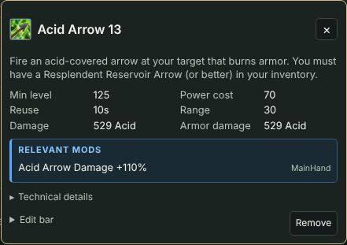

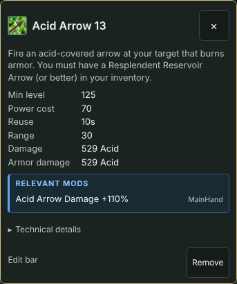

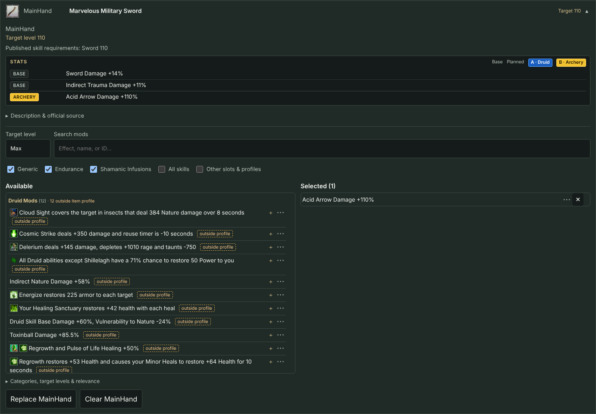

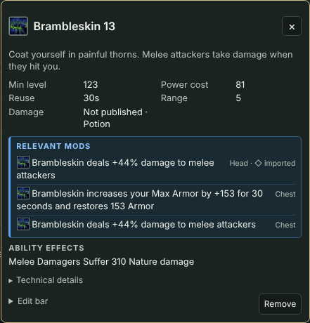

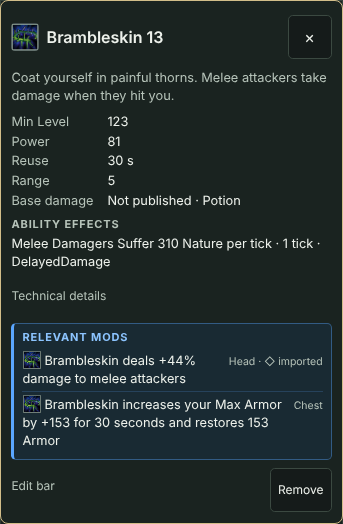

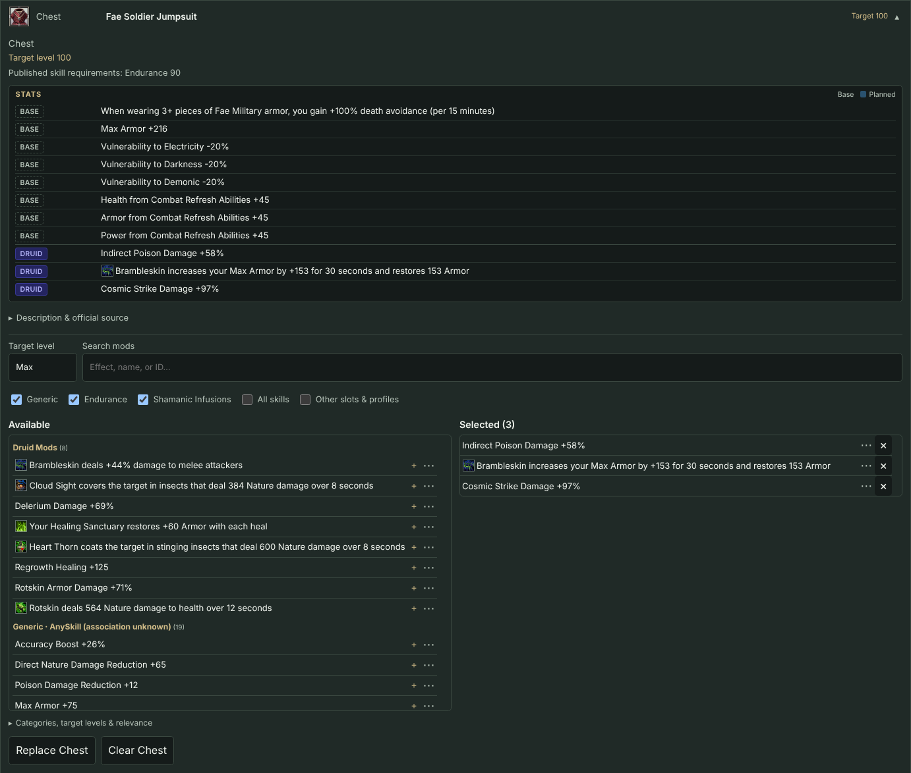

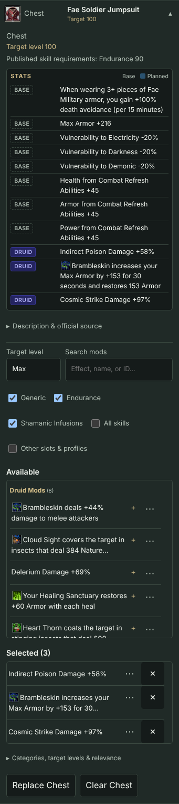

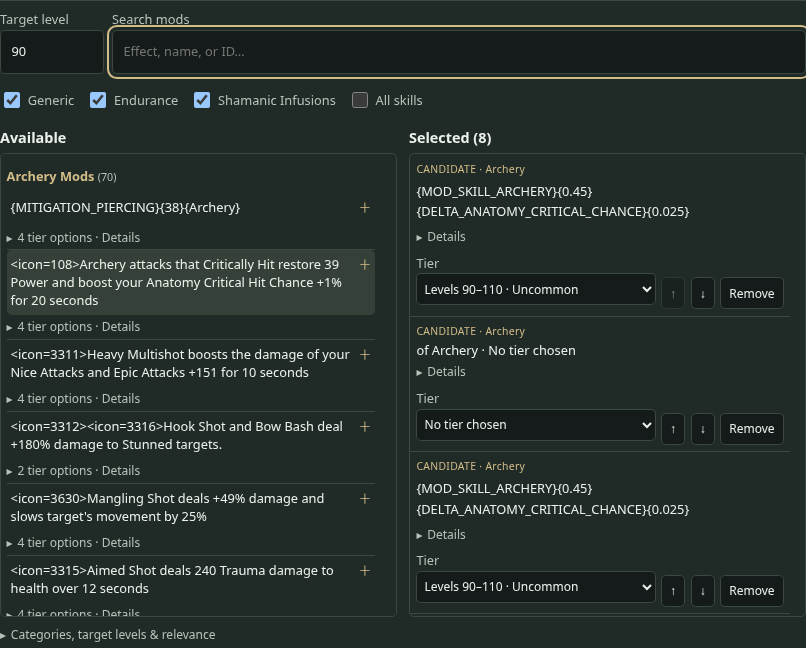

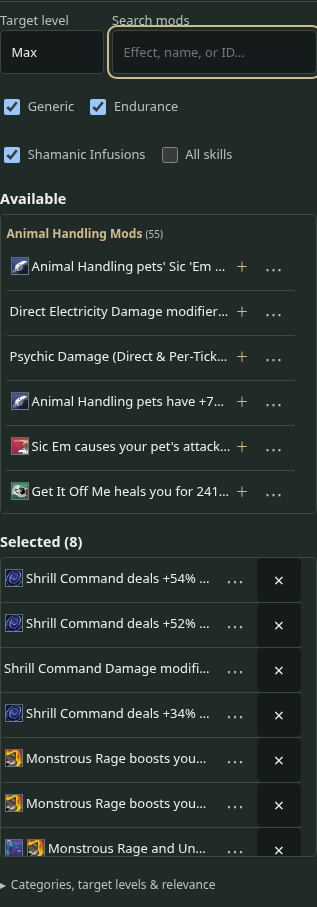

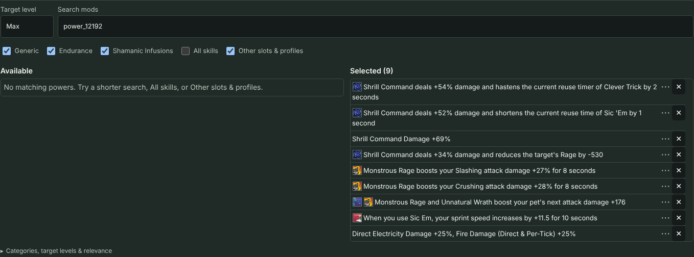

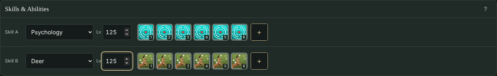

[Full desktop context (1440)](screenshots/t0010/page-desktop.png) · [Full mobile context](screenshots/t0010/page-mobile.png) · [Planner at 1920](screenshots/t0010/planner-1920.png) · [Planner at 2560](screenshots/t0010/planner-2560.png)

## Customer acceptance checklist

1. At 100% zoom choose Skill A **Druid**, leave B empty and equip a **Chest** (e.g. Fae Soldier Jumpsuit). Druid Mods should list **11** distinct entries, with no level copies. Set Max, then 100: values change and the count does not.
2. Click a Druid mod: it leaves Available and appears in Selected and as a blue **DRUID** STATS row. Remove it: it returns. Repeat after changing the target and after a refresh.
3. Check STATS: every fixed effect is shown without a dropdown (e.g. **Vulnerability to Electricity -20%**, **Max Armor +216**), with no CANDIDATE labels and aligned chips.
4. Change Druid to another skill or clear it: Druid mods clear on every item, a notice appears, and Undo restores them. With Druid in both slots, clearing one keeps the mods.
5. Equip gear with no combat skills: Available should prompt for a skill. Existing saved candidates must still show.
6. Select Archery and Cow, then A+A; check distinct/unique group headings. Toggle Generic, Endurance and Shamanic Infusions independently. Inspect the explicit AnySkill/Unknown caveats.
7. Compare item contexts. Use All skills, Other slots & profiles and the inline effect/name/ID search for broader exploration.
8. Check actual inline game icons and player-facing percentages (e.g. select Animal Handling: **Direct Electricity Damage +25%, Fire Damage (Direct & Per-Tick) +25%** visible in full without ⋯; hover for “Requires Animal Handling active”), open ⋯ to read full text/source or edit a tier. Set Max, 90 and 100. Observe changed Available effect values; click one to add exactly that displayed tier. Inspect overlapping alternatives in Details.
9. Add more than six different candidates. Check immediate Planned STATS rows separately from Base and ◇ Imported. Edit/null a tier, move and remove candidates; check immediate reversal.
10. Change the target again: saved tiers must remain unchanged, with a small preview-difference flag where applicable. Wait for Saved, refresh and verify exact order/IDs/nulls and canonical item slot.
11. Check both ability bars, other equipment, existing imported/manual powers and Sparks. Verify the skill dropdown and levels still work without the magnifier; ability search remains available.
12. Repeat by keyboard and at 375px. Confirm inline columns stack and controls/effects fit without horizontal scrolling.
13. At your normal monitor width and **100% browser zoom**, confirm the planner uses the width (up to 1600px), effects are readable without ⋯, and Skill A/B levels 100, 110 and 125 are fully visible and editable.

## Risks and follow-ups

Final-revision ambiguities:
- **Slot/profile filtering is published data, not full legality.** Item profiles describe random generation. Endurance and Shamanic powers have no item-referenced profile, so only their slot is used.
- **Generic keeps same-attribute pairs** with different official tier tables (e.g. PowerBoostVeryWeak vs ShoddyPowerBoost) as separate entries.
- **The Druid Chest count of 11 is derived from the data, not hard-coded.**
- **Inferred formats:** AsDoubleTimes100 percentages and AsBool Yes/No are marked inferred.

AnySkill cannot prove a universally eligible Generic category, overlapping tier ranges/rarities do not identify a unique legal tier, and Max cannot prove numeric effect strength. The UI and pure logic keep these limitations explicit. Raw source remains byte-exact. Percent presentation is confirmed by external player-facing references for AsBuffMod and AsPercent. AsDebuffMod (28 lines) and `%`-labelled AsDoubleTimes100 (71 lines) are inferred from official structure and type naming. 19 non-`%` AsDoubleTimes100 lines (mount acceleration) keep unchanged values with an explicit “scale unverified” flag. If the Product Owner finds an in-game display that differs for these less common types, it is a one-line change to the display-type sets. No damage math is added.

No new unrelated issue was implemented. KI-0009 representative-device load/memory monitoring and KI-0010 optional equipment backdrop dismissal remain separate follow-ups. After acceptance/merge, synchronize Tickets, Repo_Current_State, MVP notes and Manual_Verification_Guide with the accepted inline workflow. Architectural re-review and Product Owner acceptance remain pending; do not merge or mark T0010 complete based solely on these checks.
