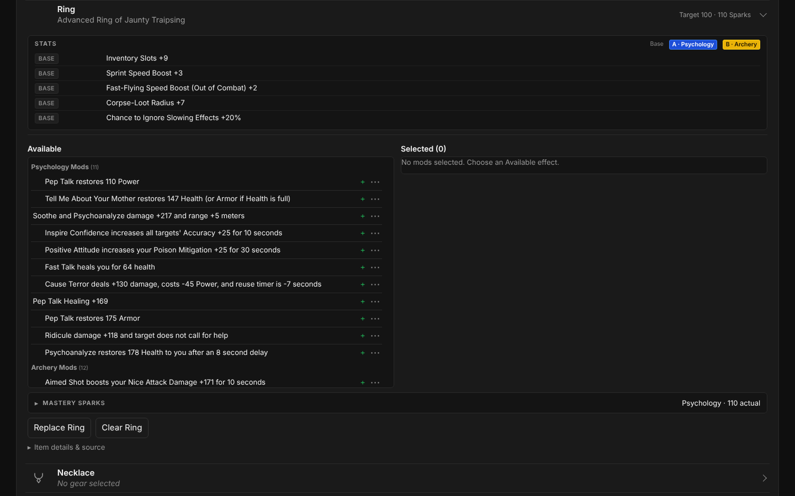
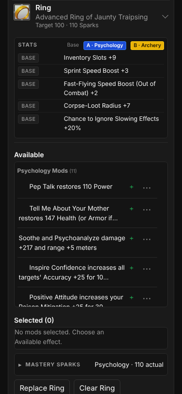
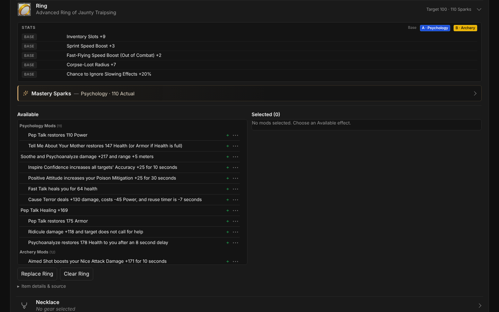
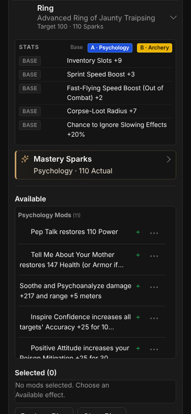

# T0015 Verification — Mastery Spark Simulation, UI, and Damage Integration

**Status:** Implemented for architect and customer review (not merged)
**Baseline:** `main` at `430f92b` (T0014-F1 merged)
**Verification class:** Customer hands-on
**Schema:** BuildDocument v1 unchanged; no migration and no new dependency

## Implemented

- Pure, React-free Spark engine in `src/core/sparks`: model table, seeded RNG, `simulateSkillDamageSparks`, analytical expected values, bonus totals and semantic configuration evaluation.
- Immutable Spark edits (`src/core/build/sparks.ts`) wired into the existing `editBuild` / autosave path as one new `sparks-set` edit.
- Spark outcomes become ordinary normalized modifiers in `aggregateBuildModifiers` (`src/core/calculation/spark-modifiers.ts`) and therefore flow unchanged through `calculateAbilityDamage`, the target dummy, the critical stage, Stampede/proc scenarios and the public Damage breakdown.
- A compact, collapsed-by-default **Mastery Sparks** panel (`src/features/sparks/SparkEditor.tsx`) inside the expanded MainHand, OffHand, Ring and Necklace rows: No Sparks / Simulate / Enter Actual Results, active-skill selection, count (default 110), Reroll, outcome counts and current bonuses, a separate **Expected average** disclosure, and a concise row note such as `Target 100 · 110 Sparks`.

## Simulation model `skill-damage-sparks-v1`

| Order | Outcome (saved key) | Weight | Normalized category | Per outcome |
|---|---|---|---|---|
| 1 | `allDirectDamagePercent` | 10 | `all-direct-damage-percent` | +0.50% |
| 2 | `skillDamageFlat` | 40 | `skill-damage-flat` | +1 |
| 3 | `allDirectDamageFlat` | 10 | `all-direct-damage-flat` | +1 |
| 4 | `skillDamagePercent` | 24 | `skill-damage-percent` | +1% |
| 5 | `skillBaseDamagePercent` | 16 | `skill-base-damage-percent` | +3% |

Weights are whole-percent integers totalling exactly 100, so probabilities sum to exactly 1.

**Algorithm.** The seed string is hashed with cyrb128 (four 32-bit words), which seeds an sfc32 generator; the first 15 outputs are discarded. Each Spark draws an exactly uniform integer `r` in `[0, 100)` by rejection sampling (values `≥ 2³² − (2³² mod 100)` are redrawn, so there is no modulo bias) and selects the first outcome whose cumulative weight (10, 50, 60, 84, 100) exceeds `r`. Only 32-bit integer operations are used; `Math.random()` is never called. A count of *n* uses the first *n* rolls of the seed's stream. The skill names the recipient but does not change the rolls. The UI chooses a new 16-hex-character seed with `crypto.getRandomValues` only when the user rerolls or first enables simulation.

**Reproducibility.** A simulated configuration saves `{ skillId, count, seed }` and `{ modelVersion, outcomeCounts }`. Every evaluation re-simulates from the saved input and applies the result only when the model version and all five counts match. A different model version, tampered counts, a missing result, counts outside 0–110 or a malformed seed are preserved in the build, reported as an aggregation warning and never applied. Changing the RNG, thresholds or table order requires a new model version (a test pins the first rolls and totals for seed `gorgon-t0015`).

**Validation.** Counts must be whole numbers 0–110; actual results must be five non-negative whole numbers totalling at most 110; the skill must be an official combat skill; seeds are non-empty strings of at most 128 characters. Schema validation stays structural, as before, so older drafts never fail to load. Semantic checks happen in `evaluateSparkConfiguration` (used by aggregation and the UI) and in `editSparks` (which rejects invalid edits without changing the build).

## Expected values (independent of simulation)

`expectedSkillDamageSparks(count)` computes each value as one exact integer numerator divided once, so values are correctly rounded and linear in the count:

| Bonus | 110 Sparks | Arithmetic |
|---|---|---|
| All Direct Damage % | +5.5% | 110 × 0.10 × 0.5 |
| Skill Damage | +44 | 110 × 0.40 × 1 |
| All Direct Damage | +11 | 110 × 0.10 × 1 |
| Skill Damage % | +26.4% | 110 × 0.24 × 1 |
| Skill Base Damage % | +52.8% | 110 × 0.16 × 3 |

Expected values are shown only in the **Expected average** disclosure, labelled as a long-run average, not a guaranteed result, and not applied to damage. They are never injected into aggregation.

## Modifier mapping and applicability

One modifier is emitted for each non-zero outcome on each item, keyed `equipment:<slot>#<n>/sparks:<outcome>`, after the item's fixed effects, existing powers and staged mods. Each modifier uses the **official attribute of the same category**, interpreted by the existing registry:

| Outcome | Attribute | Scope | Unit / value |
|---|---|---|---|
| +0.5% All Direct | `MOD_UNIVERSAL_DIRECT` | general, direct | fraction, count × 0.005 |
| +1 Skill | `BOOST_SKILL_<SKILL>` | skill | points, count |
| +1 All Direct | `BOOST_UNIVERSAL_DIRECT` | general, direct | points, count |
| +1% Skill | `MOD_SKILL_ALL_<SKILL>` | skill | fraction, count × 0.01 |
| +3% Skill Base | `MOD_SKILL_<SKILL>` | skill | fraction, count × 0.03 |

- Skill outcomes apply only where the official ability lists that attribute in its `AttributesThatDeltaDamage` / `AttributesThatModDamage` / `AttributesThatModBaseDamage` hook, exactly like gear. Another skill's abilities exclude them as `skill-mismatch`.
- All Direct outcomes follow the existing direct-delivery rule, so they reach any direct hit, including a second combat skill's abilities.
- If a skill has no matching official attribute (for example Hammer has no `MOD_SKILL_ALL_HAMMER`; Animal Handling's `BOOST_SKILL_` label names two abilities), that outcome is an explicit `unsupported` record. Nothing is invented, and the editor shows **Not modeled** for that row.
- Provenance: `source.kind = 'spark'` with slot, equipment key/index, item kind/ID, mode, skill, outcome, outcome count, total Sparks, model version and seed (simulated only). The public breakdown labels each step, for example `Psychology Base Damage % — Ring Sparks`; the report formatter and the `?debugDamage=1` view show full provenance.
- Each modifier carries `requires-active-skill` for its configured skill. When that skill is not active, all five outcomes are `conditions-not-met`: they are kept, never remapped, and excluded by the engine. The editor reports the inactive skill.
- Configurations saved on unsupported slots, or on conflicting legacy offhand entries, are preserved and reported (`spark-slot-unsupported`, `spark-offhand-conflict`) without contributions. Pending and invalid configurations produce `spark-result-missing` and `spark-configuration-invalid`. These four codes replace T0012's `sparks-not-aggregated`.

## Formula assumptions and limitations

- **Unchanged formula.** Spark modifiers are ordinary inputs to the T0013 provisional formula. Skill Base remains `original base × fraction`, added after other contributions. No ordering changed.
- Spark confidence is `assumed`. Probabilities and per-outcome values are the product-owner model, not official data, and remain unvalidated in game. Results remain **Estimated** publicly.
- **Assumed:** every outcome on an item, including All Direct outcomes, requires the configured skill to be active (`SPARK_ASSUMPTIONS.activeSkill`).
- **Eligibility.** Official v490 Spark scrolls name Main-Hand Weapons, Off-Hand Weapons, Ring-slot and Necklace-slot equipment. A shield in the exclusive offhand position can be planned; the editor states that shield eligibility is unconfirmed. Rarity/Mastercrafted/Prophecied status is not inferred from metadata, and missing rarity does not block planning.
- Spark outcomes are never inferred from CharacterSheet/Storage, `CraftPoints` or rarity (KI-0003 unchanged).

## Behavior change: replacing an item clears its Sparks

Sparks belong to the physical item. Replacing an equipped item with a different item now resets that entry's Sparks to `none`. Staged candidate mods are still retained. The existing replacement confirmations name the cleared Sparks, and replacing a database item that has Sparks configured now also asks for confirmation from a slot picker. The equipment picker's replacement note says the same. This supersedes the T0009/T0009-F1 statement that Spark settings survive replacement, which predates any Spark meaning. Five existing tests that asserted Sparks survive replacement were updated to assert they are cleared. Their candidate-retention assertions are unchanged.

Unchanged: clearing an item (existing confirmation), **Clear build**, a skill change (Sparks are never pruned or remapped), treasure-mod and imported-power edits, and read-only/protected drafts (all Spark controls disabled; nothing written).

## Automated results

| Check | Result |
|---|---|
| `npm run data:update -- --check` | Validated/reused official v490 |
| `npm run lint` | Pass (0 warnings) |
| `npm run typecheck` | Pass |
| `npm test` | **1,246 passed / 63 files** (baseline 1,164 / 59; 82 new) |
| `npm run coverage:treasure -- --check` | Committed reports current |
| `npm run build` | Pass; main chunk 508.5 → 530.1 kB (pre-existing >500 kB warning) |
| `git diff --check` | Clean |

New focused suites: `src/core/sparks/sparks.test.ts` (45: model, RNG, 0/1/37/110 rolls, conservation, pinned seed, independence, invalid input, expected values, evaluation), `src/core/build/sparks.test.ts` (15: edits, rerolls, validation, slots, offhand conflict, replacement), `src/core/calculation/sparks-damage.test.ts` (11: mapping, units, scopes, provenance, four slots, no double counting, inactive skill, unsupported attributes, exact Mock/Aimed Shot deltas, Skill Base original-base basis, removal/reroll, target/critical stages), and `src/features/sparks/SparkEditor.test.tsx` (11: UI flows, refresh, invalid input, read-only, replacement confirmation, offhand conflict, treasure-edit isolation).

## Browser verification

`node src/features/sparks/sparks.smoke.mjs --mode dev|preview` (Chromium, synthetic official-ID draft) passed in **Vite dev** and **production preview** at **1440 × 900, 375 × 812 and 320 × 812**, 18 scenarios per mode. It covers the editor in all four rows (collapsed by default), keyboard selection of Simulate, 110 outcomes, bonus = outcomes × value, reroll (new seed, recomputed counts, other gear byte-identical), refresh with identical storage and display, actual 11/44/11/26/18, the rejected 111 total, Ring + Necklace combining, Necklace removal, re-targeting the Ring to Archery, reset to the exact baseline, a public breakdown with source labels and no diagnostics, the popover staying inside the viewport, no page or console errors, and no horizontal overflow beyond the pre-existing 2 px at 320 px. Evidence: [`docs/verification/t0015/`](verification/t0015/).

## Manual verification (product owner)

Use a fresh build (**Clear build**). Set **Psychology 100** in Skill A and **Archery 100** in Skill B. Equip **Mock 11** in bar A and **Aimed Shot 5** in bar B, then turn on **Damage analysis**. Equip MainHand *Guardian Trident*, OffHand *Practice Crossbow*, Ring *Advanced Ring of Jaunty Traipsing* and Necklace *Incredible Enchanted Necklace*; none has a damage effect.

1. Expand each of the four rows: each shows a collapsed **Mastery Sparks** panel reading *None*. Head/Chest/etc. have none.
2. Ring → Mastery Sparks → **Simulate**. Skill defaults to Psychology and Sparks to 110.
3. Confirm the Total row reads **110 / 110**.
4. Each Bonus equals Count × value (+0.5%, +1, +1, +1%, +3%).
5. Open Mock 11: Health hit changes from **178** to a higher Estimated value. Open **Damage breakdown**: rows read `… — Ring Sparks`, and Skill Base says `of original base 178`.
6. **Reroll**: the Seed text changes and the counts/bonuses and Mock value recalculate.
7. Refresh the page: the same seed, counts and Mock value return.
8. **Enter Actual Results** and type 11, 44, 11, 26, 18. Bonuses read +5.5%, +44, +11, +26%, +54%. Mock reads **402.52** and Aimed Shot reads **255.31**. Typing 45 for +1 Psychology Damage shows *Total 111 is over 110. Not saved.*
9. Necklace → Enter Actual Results → +1 All Direct Damage = 5: Mock becomes **409.09** (both items combine).
10. **Clear Necklace** (confirm): Mock returns to 402.52. Replace the Ring with another ring: the confirmation says its Spark settings will be cleared, and the new ring shows *None*.
11. Aimed Shot (Archery) received only the All Direct outcomes in step 8 (255.31, not more). Change the Ring's Sparks skill to Archery to move the skill bonuses to Aimed Shot.
12. Repeat steps 2–8 at 1440, 375 and 320 px widths: there is no sideways scrolling and the controls are reachable by keyboard (Tab to the mode buttons, arrow keys switch).

### 0 vs 110 Sparks (Ring, Psychology, actual 11/44/11/26/18)

| | 0 Sparks | 110 Sparks | Delta |
|---|---|---|---|
| Bonuses | — | +5.5% All Direct, +44 Psychology, +11 All Direct, +26% Psychology, +54% Psychology Base | |
| Mock 11 health hit | 178 | 402.52 | **+224.52** |
| Mock arithmetic | 178 | 178 + 44 + 11 = 233; 233 × (0.26 + 0.055) = 73.395; 178 × 0.54 = 96.12 → 402.515 | |
| Aimed Shot 5 hit | 231 | (231 + 11) × 1.055 = 255.31 | **+24.31** |

## Known issues and deferred behavior

- In-game validation of Spark values, the active-skill requirement and stacking with gear is still required; results stay **Estimated**.
- Shield eligibility for Mastery Sparks is unconfirmed; it is planned like an offhand.
- Percentile/luck context and an optimizer remain out of scope (Product Decisions: *eventually*).
- The editor remembers the last configuration of each mode for the same item during the session only. Switching modes is otherwise an explicit overwrite.
- The main JS chunk grows by about 21.5 kB minified (6.6 kB gzip). The >500 kB warning pre-exists.

## Recommended post-merge documentation updates (not edited here)

- `docs/Repo_Current_State.md`: add T0015 to completed tickets with the PR, merge commit and test count. Add `src/core/sparks` and `src/features/sparks` to the source tree. State that T0016 is next.
- `docs/Tickets.md`: mark T0015 implemented/accepted. Note the replacement-clears-Sparks decision.
- `docs/Manual_Verification_Guide.md` (Spark Tickets): link this report and add the 0-vs-110 table.
- `docs/Known_Issues_And_Followups.md`: in-game Spark validation; shield eligibility; percentile/luck follow-up; KI-0003 unchanged.
- `docs/Product_Decisions.md` (Mastery Sparks): record that Sparks belong to the item and are cleared on replacement, and the assumed active-skill requirement for All Direct outcomes.

---

## R1 correction — Mastery Sparks visibility and Stampede effective contributions

**Scope:** applied to the existing PR #42 on `feature/t0015-mastery-sparks`, following customer testing of T0015. The T0015 history above is unchanged. BuildDocument v1, Spark model `skill-damage-sparks-v1`, its probabilities, the five outcome categories and the replacement-clears-Sparks behavior are all preserved.

### A. Mastery Sparks UI

Customer feedback: the panel was hard to notice, low-contrast, looked like a minor treasure-mod subsection and sat below the long Available / Selected editor.

**Changes (presentation only; the editor internals are unchanged):**

- Expanded order for MainHand, OffHand, Ring and Necklace: **1. STATS → 2. Mastery Sparks → 3. treasure mods (Available / Selected) → 4. Replace / Clear → 5. Item details & source** (`EquipmentPlanner.tsx`).
- Redesigned header (`SparkEditor.tsx`, `sparks.css`):
  - Spark icon and a full-contrast "Mastery Sparks" heading (0.9375 rem, 600), followed by a readable summary.
  - Restrained bronze accent: a 3 px left rule, a faint border tint and the selected-mode underline. Accent #c9a26b on the surface is about 7.6:1 contrast.
  - Expand/collapse chevron matching the equipment rows; collapsed height 2.75 rem.
  - At ≤ 30 rem width the summary wraps under the heading instead of truncating.
- Summary states: `— None`, `— Psychology · 110 Simulated`, `— Psychology · 110 Actual`, `— Cow · 75 Simulated`, `— Cow · 110 · Inactive`, `— Not simulated`, `— Not applied` (amber). The summary's accessible name is "Mastery Sparks: …".
- Everything else is unchanged: modes, skill choice, 0–110 count, reroll/seed, manual entry, counts, bonuses, separate expected averages, read-only/disabled states, unsupported-attribute notes and offhand conflict handling.

| | 1440 px | 375 px |
|---|---|---|
| Before (below mods) |  |  |
| After (collapsed) |  |  |

Expanded evidence: [1440 px](verification/t0015-r1/after-1440-expanded.png) and [320 px](verification/t0015-r1/after-320-expanded.png).

### B. Stampede effective contributions (0–30)

**Customer measurements:**

- Setup: Stampede 12 (2 s reuse), Continuous Trampling "+N for 60 seconds", an applicable ≈1.955× percentage multiplier, and an unrelated in-game buff that shifts only the baseline.
  - Test A, +56 only: 1,384 → 4,669, an increase of **3,285**. Predicted: 56 × 30 × 1.955 = **3,284.4**.
  - Test B, +50 and +56: 1,384 → 7,601, an increase of **6,217**. Predicted: (50 + 56) × 30 × 1.955 = **6,216.9**.
- Damage keeps rising for about 30 consecutive attacks. With a 60 s buff and a 2 s reuse, about 60 / 2 = 30 contributions overlap before the oldest expire. **Thirty is that practical steady state, not a game-defined stack cap.** The official v490 tier text still reads "(stacks up to 15 times)"; it is kept and matched unchanged, and is no longer treated as the scenario limit.

**Changed (only the range and wording):**

- `damage-scenarios.ts`: `STAMPEDE_MAX_CONTRIBUTIONS = 30`; `isValidStampedeStacks` accepts integers 0–30; the warning text is updated.
- `DamageScenarios.tsx`: the selector offers 0–30, and its tooltip explains the 60 s / 2 s steady state.
- `stampede-scenario.ts` (no code change): session validation already reuses `isValidStampedeStacks`, so stored 0–15 values still restore and 31, negative, fractional or malformed values fall back to 0.
- `scenario-treasure-rules.ts`: the rule description and Estimated assumption text are updated. The exact matcher pattern is unchanged.

**Formula unchanged:** flat bonus = contributions × Σ applicable Continuous Trampling values. It enters the existing T0013 formula before ordinary percentages. There is no new multiplier and no duplicated contribution, and the scenario stays **Estimated**. While Stunned still uses its separate provisional percentage stage. No other damage path, Spark stage, critical, proc, target or Skill Base calculation changed. Ordinary results for every ability are byte-identical for any selected contribution count.

### Numerical regression (`src/core/calculation/stampede-contributions.test.ts`)

The 1.955× multiplier is produced through ordinary modifiers: 95 × "+1% Cow Damage" plus 1 × "+0.5% All Direct" actual Sparks, for +95.5%. Stampede's published base is 208, so the planner baseline is 406.64.

| Configuration | Contributions | Expected increase | Test result | Browser (preview) total |
|---|---:|---:|---:|---:|
| +56 only | 0 | 0 | 0 | 406.64 |
| +56 only | 15 | 1,642.2 | 1,642.2 | — |
| +56 only | 30 | 3,284.4 | 3,284.4 | — |
| +50 and +56 | 0 | 0 | 0 | 406.64 |
| +50 and +56 | 15 | 3,108.45 | 3,108.45 | 3,515.09 |
| +50 and +56 | 30 | 6,216.9 | 6,216.9 | 6,623.54 |

Both measurements are reproduced within 1 damage (3,285 vs 3,284.4; 6,217 vs 6,216.9). With the example planner baseline of 1,335.67, the totals are **4,620.07** (+56, 30) and **7,552.57** (+50/+56, 30). The 48.33-point baseline difference from the customer's unrelated buff is not "corrected" by changing the formula.

Other R1 tests:

- 0/1/15/16/29/30 valid and −1/31/1.5/NaN/∞ invalid.
- Stored session values 0–30 restore; 31, `"15"`, `null`, `{}` and malformed text fall back to 0.
- The stack flats are `[1500, 1680]`, and the percentage basis is 208 + 3,180.
- Removing the +50 source gives 3,284.4; changing it to +4 gives 60 × 30 × 1.955; restoring it gives the identical combined result.
- While Stunned at 30 contributions: off = 1,708; on = 1,708 × 14 = 23,912 (+1,300%).
- Contribution changes never alter the ordinary Stampede hit, an unrelated Cow ability or the Spark simulation.
- The UI selector has 31 options; 30 shows 1,708 and "+50 per stack × 30".

Obsolete 15-limit assertions were updated, not deleted.

Evidence: [Stampede 30 contributions, 1440 px](verification/t0015-r1/after-1440-stampede-30.png), [375 px](verification/t0015-r1/after-375-stampede-30.png).

### R1 automated and browser results

| Check | Result |
|---|---|
| `npm run data:update -- --check` | Validated/reused official v490 |
| `npm run lint` / `npm run typecheck` | Pass |
| `npm test` | **1,272 passed / 64 files** (T0015: 1,246 / 63; +26) |
| `npm run coverage:treasure -- --check` | Committed reports current |
| `npm run build` | Pass (main chunk 530.9 kB; the >500 kB warning predates T0015) |
| `git diff --check` | Clean |
| Spark smoke (`sparks.smoke.mjs`) | Dev and preview pass at 1440/375/320 px, 18 scenarios each |
| Stampede/proc smoke (`damage-scenarios.smoke.mjs`, extended to 16/30 and 30 + While Stunned) | Dev and preview pass at 1440/375/320 px |

No console errors, and no new horizontal overflow. Results: [`docs/verification/t0015-r1/`](verification/t0015-r1/).

### Updated customer verification (R1)

1. Expand a Ring, MainHand, OffHand or Necklace. **Mastery Sparks** appears directly under STATS, above Available / Selected.
2. The collapsed header reads, for example, "Mastery Sparks — None". Open it: the chevron turns and the editor appears. Close it again.
3. Simulate, Reroll, enter actual results and refresh, as in T0015 steps 2–8. The header updates (for example "Psychology · 110 Actual").
4. Select Cow and equip **Stampede 12**. Stage Continuous Trampling **+50** (tier `id_20`) and **+56** (tier `id_22`) on Chest/Hands, and turn on Damage analysis.
5. Set **Current Stampede stacks** to 0, 15 and 30. With your gear's multiplier *m*, each step from 0 should add 106 × contributions × *m*. At *m* = 1.955 that is +3,108.45 at 15 and +6,216.9 at 30.
6. Remove +50: the 30-contribution increase becomes 56 × 30 × *m* (3,284.4 at 1.955). Re-add +50 and the combined increase returns.
7. Toggle **While Stunned** (Necklace mod) and confirm its separate conditional row still changes only the stunned value.
8. Open **Damage breakdown**: the Chest and Hands contributions are listed separately, for example "+50 per stack × 30 = +1,500" and "+56 per stack × 30 = +1,680".
9. Check 1440, 375 and 320 px widths.

### R1 limitations

- Thirty contributions are only validated for the current 60 s buff and 2 s reuse. Other reuse times, haste and the exact behavior at the expiry boundary are not modeled. There is no rotation, timeline or cooldown simulation.
- The scenario remains **Estimated** pending broader game-mechanics validation.
- The customer's baseline differs by about 48 points because of an unrelated buff, so only the increases are compared.
